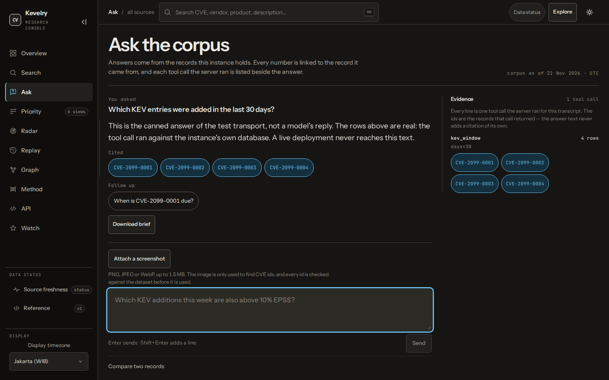
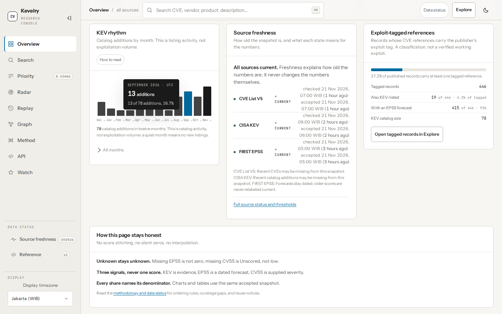
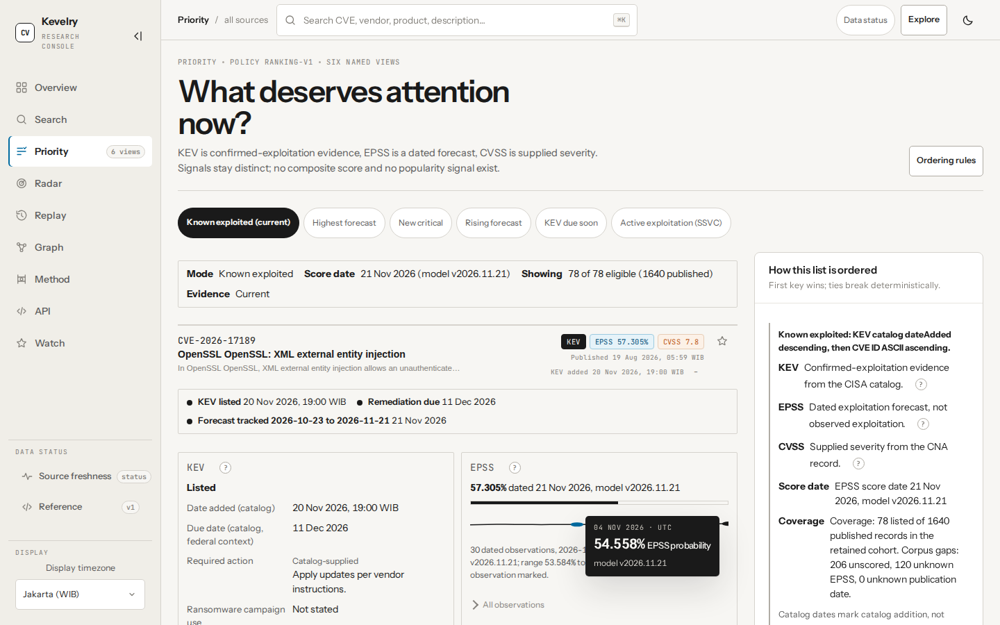
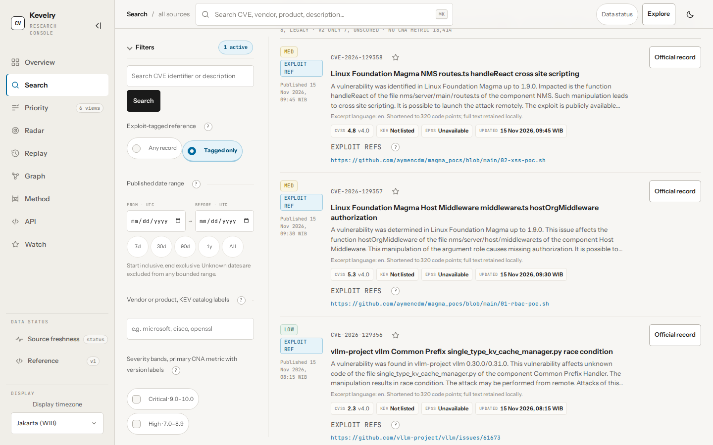
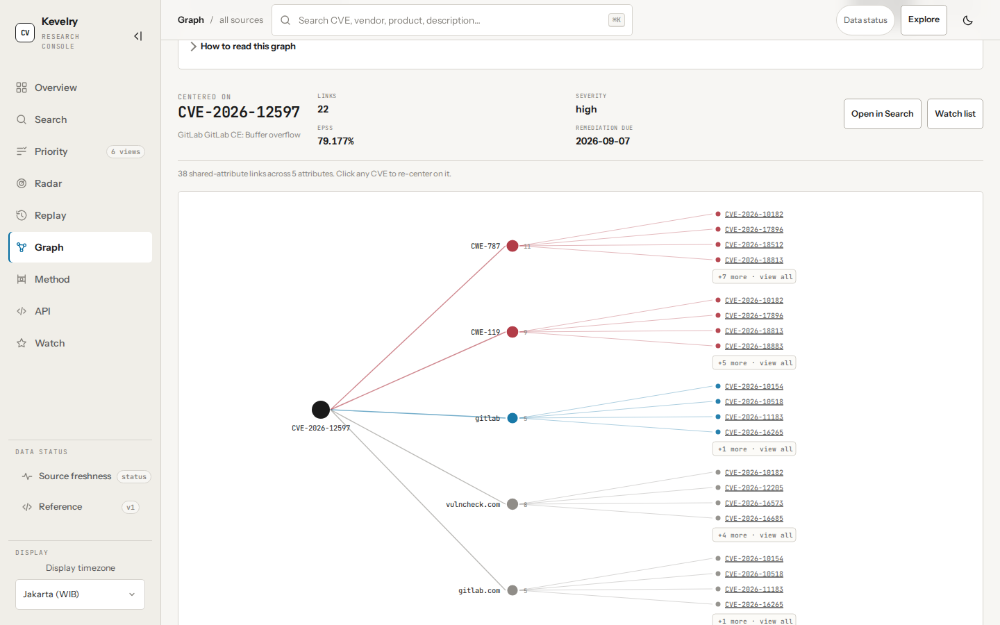
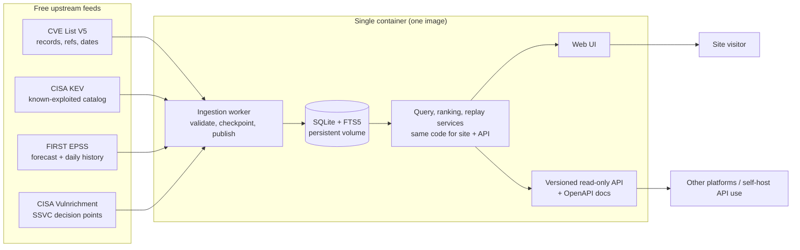
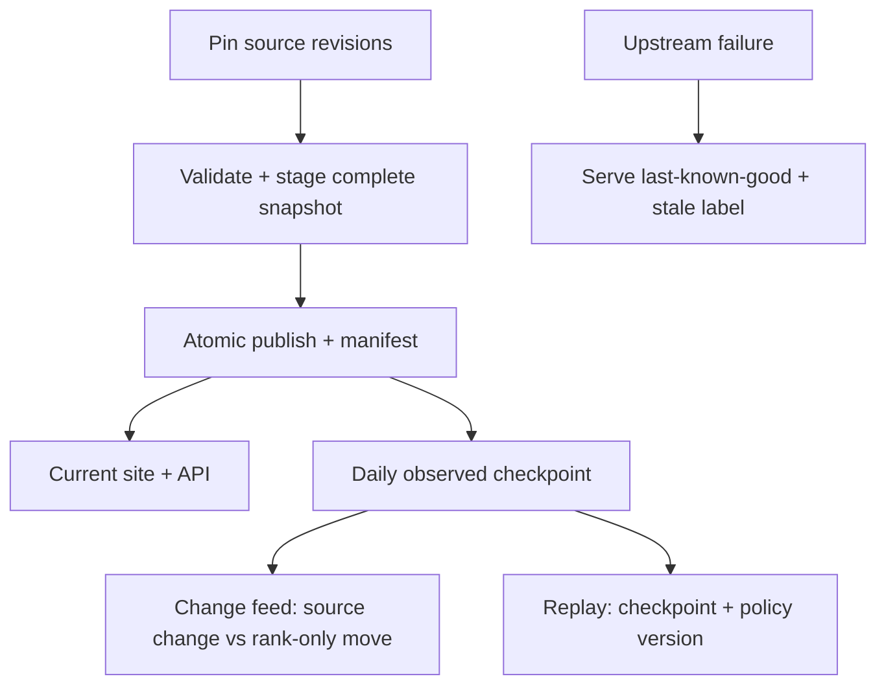

# Kevelry (cve-change-radar)

[](https://github.com/momokii/kevelry/actions/workflows/ci.yml)
[](LICENSE)
[](package.json)

**Naming:** **Kevelry** is the public name (repository, wordmark). The package and
image name stays `cve-change-radar` (local folder `cve-injector`); all three refer
to this one app. Internal names were kept stable so existing volume and image
references never break.

Kevelry is a **self-hosted CVE intelligence console**. An ingestion worker pulls
four free upstream feeds — CVE List V5, the CISA KEV catalog, FIRST EPSS, and
CISA Vulnrichment's SSVC decision points — into one local SQLite database, and
the web app serves a chart-first console plus a versioned **read-only** API over
that snapshot. It runs as **one Docker image, one container, one volume**, with
no account system, no external service in the request path, and no composite
risk score.

> **Status:** `3.2.3` is the newest published image (`kelanach/kevelry`), and
> `latest` resolves to it; `3.2.2` (2026-11-22), `3.2.1` (2026-11-22), `3.2.0`
> (2026-11-21), `3.1.0` (2026-11-20) and `3.0.2` (2026-11-17) remain available as
> previous releases. The `3.2.3` entry in [CHANGELOG.md](CHANGELOG.md) lists what
> changed and the upgrade notes — no migration, no API change. It builds on the
> `3.2.2` schema **migration 010**, which widens the `sync_runs` status CHECK to
> allow `interrupted` (schema max version 010); it runs automatically on boot
> against an existing volume, with no manual step.
>
> **The v4 assistant documented below is on `main`, not in a published image**
> (documented 2026-11-22). It is off unless an operator sets `AI_ENABLED=true`
> and a gateway key, and it needs **migration 011** (`ai_usage`) on the next
> upgrade.

## What v4 adds

The headline is an **AI research assistant** — rail item `Ask`, page
`/assistant`. You ask a question about this instance's corpus in plain language;
the answer is produced **only** through tool calls over this deployment's own
data. Eight read-only tools sit over the same loaders the pages use, with row and
time caps, and every number in an answer is traceable to the tool call that
produced it in the **evidence ledger** beside it: one monospace line per tool
call with its arguments, row count and record ids. Citations are built **by the
server** from that turn's tool results and never scraped from the model's prose,
so a record the model did not actually read cannot appear as a link. The
transcript is the browser's: nothing you type is stored, logged or persisted
server-side, and the only write a turn makes is the aggregate spend row in
`ai_usage`.

The trade is stated rather than hidden. An answer is bounded by what this
deployment ingested, the tool layer can only read, and a question the corpus
cannot answer comes back as the query and its row count (`0 rows`), not as a
plausible guess. A live turn costs money, so it is capped — session tokens, a
daily `list_cost` budget kept in SQLite so a restart cannot reset it, and per-IP
rate limits — and the desk names the cap, the wait or the variable instead of
failing silently.

| Capability                    | What it adds                                                                                                                                                                                                     |
| ----------------------------- | ---------------------------------------------------------------------------------------------------------------------------------------------------------------------------------------------------------------- |
| **Grounded answers**          | `POST /api/assistant/chat` streams tool events, text, then server-derived citations; the ledger is the proof, not the prose.                                                                                     |
| **Record-scoped ask**         | `Ask about this record` (Priority row, Graph focus) opens `/assistant?cve=<id>`, which tells the turn to read that record first.                                                                                 |
| **Compare two records**       | A disclosure beside the composer sends a fixed two-id question and answers it field by field. Never a fused score, never a winner.                                                                               |
| **Brief export**              | A completed answer downloads as Markdown: the question, each claim with an absolute citation link, then the evidence ledger. Client-side, nothing stored.                                                        |
| **Screenshot intake**         | PNG/JPEG/WebP up to 1.5 MB: the prompt allows CVE ids read from an image and requires each to be resolved through `get_cve` before it is described; an id that does not resolve is stated as not in the dataset. |
| **Nothing to jailbreak into** | No shell, filesystem, host, query language or write capability exists in the tool layer. Web fetch is optional, `https`-only and host-allowlisted.                                                               |

The id rule is enforced in code, not only asked for in the prompt. Every citation
is an id a tool returned, and the turn scans the prose for ids that no tool
payload contained; a non-empty list is sent as an `unverified` event, shown above
the citations as a quiet caution, and carried into the downloaded brief under its
own heading. The answer is not blocked or rewritten — the reader sees which id is
doubtful and can treat it as a typo or a record this deployment does not hold.

### What it will not do

No exploit code, no PoC construction, no targeting advice, and no verdict — it
will not tell you what is exploitable, urgent or worth patching first. That is
the product's whole position: KEV, EPSS, CVSS and SSVC stay separate, sourced
signals and the reader draws the conclusion. A request for any of that is
refused with what the assistant _can_ do plus record-backed follow-ups. The
clearest patterns are filtered **before** inference at $0; the rest is a prompt
rule — tested against a fixture suite, never proven.

### Configuration

The assistant is **off by default**. Set `AI_ENABLED=true` and `AI_API_KEY`,
then restart. A self-hoster who sets nothing — or sets the flag with no key —
gets an honest disabled state on `/assistant` that names the variable, not a
composer that fails on submit. Every knob is in `.env.example`: the two above,
`AI_MODEL`, `AI_BASE_URL`, the two budgets (`AI_SESSION_BUDGET_TOKENS`,
`AI_DAILY_BUDGET_USD`), the turn/input caps, the two timeouts, and
`AI_WEB_FETCH_ENABLED` (off by default; when off the web tool is absent from the
tool list).

### A grounded answer, with its evidence ledger



A settled turn. The question, answer, follow-up, brief action and composer share
one left edge (no bubbles, no speaker indentation), the citation chips under the
answer link to `/explore?q=<id>`, and the **Evidence** column on the right names
the one tool call behind them — `kev_window`, `days=30`, `4 rows` — with the ids
it returned. The frame is the browser suite's offline **fake transport**
(`AI_FAKE_TRANSPORT=1`) against the seeded e2e corpus, so the prose is canned and
says so; the tool call, its row count and the citations are real.

### Compare two records, field by field


The compare disclosure beside the composer: two labelled id fields with the same
shape rules as the API, the fixed question it will send (status, dates, CVSS,
KEV, ransomware, EPSS, CWE), and the `differs` review left to the reader. This is
the entry state, before Compare is pressed — the same offline transport is wired
here, so an answer would be that transport's canned line; what the frame shows
faithfully is the surface and its validation contract.

## What v3 added

Every capability below is paired with the rule it enforces. The rule is the
point: where the data cannot support a claim, the UI says so instead of filling
the gap.

| Capability                                              | The trust rule it enforces                                                                                                                                                                                      |
| ------------------------------------------------------- | --------------------------------------------------------------------------------------------------------------------------------------------------------------------------------------------------------------- |
| **SSVC triage** (CISA Vulnrichment)                     | Exploitation / Automatable / Technical Impact are stored **verbatim** and shown beside the other signals. Never blended into a score; a record with no published block says so.                                 |
| **Exploit signal** from publisher-classified references | The CNA/ADP `exploit` reference tag is surfaced as **tagged**. Never "verified PoC", never proof of a working exploit, never a ranking input.                                                                   |
| **CWE catalog** from MITRE                              | View 1000 (956 entries) stored by migration 009 and versioned `1000-956`; chips carry the published name and let the mitigation text be read. Three states only: known, unmapped, taxonomy-unavailable.         |
| **Change feeds, export, checkpoint writer**             | Atom 1.0 and RSS 2.0 serve the same retained changes; CSV/JSON export is **page-bounded** (exactly the rows on screen, never the whole cohort); the worker writes at most one checkpoint per UTC day.           |
| **Batch lookup** — `GET /api/v1/cves/batch`             | Up to 50 records in one bounded read, with a `resolution` envelope that names every id it could not resolve, so a client cannot mistake an absent record for an empty one.                                      |
| **Secondary / ADP CVSS**                                | Every metric the primary selector did not pick is served as `cvssSecondary` — **context only**: never banded, never filterable, never ranked. The unscored cohort splits into `secondaryOnly` and `noMetric`.   |
| **Ransomware tri-state**                                | `Known (catalog)`, `Unknown (catalog)`, `Not stated`. A missing catalog field never renders as "no ransomware".                                                                                                 |
| **KEV rhythm honesty**                                  | The chart is **always twelve UTC calendar months**, and a month with no additions is a focusable `0`, not a missing bar.                                                                                        |
| **Inspectable data** (`DESIGN.md` §7.0)                 | Every chart mark is hover- and keyboard-reachable, the tooltip has one fixed label/value/context shape, and a value is never hover-only — it is also at the mark, in the caption, or in the chart's data table. |

## Screenshots

All four are 1440×900 captures of a production build against a **seeded demo
corpus** — 1,640 published records, 78 KEV entries, 30 daily EPSS observations —
not the live instance, so the numbers in the frames are reproducible rather than
current. For the deployment's own figures, read `/methodology`, which counts the
accepted snapshot. The two assistant captures live under
[What v4 adds](#what-v4-adds); they come from the browser suite's dev server with
its offline transport, which their captions state.

### Overview — the KEV rhythm, one month hovered



A September 2026 bar is hovered. The tooltip names the month with its UTC basis,
prints the exact count (`13 additions`), and gives the share of the twelve-month
window (`13 of 78 additions, 16.7%`). The Source freshness panel beside it names
each source's accepted revision and says whether it is current.

### Priority — one expanded known-exploited row and a point-by-point EPSS sparkline



KEV catalog facts (listed date, due date, required action, ransomware state) sit
beside the EPSS block, which prints `57.305%` for the accepted score date. The
pointer is over the sparkline, and the tooltip prints one dated observation at
full precision: `06 NOV 2026 · UTC`, `54.554% EPSS probability`, `model
v2026.11.21` — never rounded to a whole percent.

### Explore — filters and rows, with exploit-tagged references



The exploit-tagged filter is on: the filter rail shows one active filter and
`SHOWING 1–20 OF 446`, and the rows underneath carry their severity band, KEV
state, EPSS value and the tagged exploit reference links. Severity bands no
record in the corpus carries are printed as `0` rather than dropped.

### Graph — a bounded KEV cohort



Centred on CVE-2026-12597: `22 links` on the record, `38 shared-attribute links
across 5 attributes` below it — the CWE-787 and CWE-119 catalog weakness classes,
the catalog vendor, and advisory hosts such as `vulncheck.com` and `gitlab.com` —
with capped groups stating `+N more · view all` instead of drawing a silently
truncated cohort.

## Quickstart

Prerequisites: Docker with Compose v2, and roughly **12 GB free disk at peak**
(image ≈0.5 GB, the CVE List V5 checkout cache 5–6 GB, the SQLite database 5–6 GB
plus WAL and growing with the EPSS retention window).

```bash
./setup.sh                    # check-only: Docker, daemon, compose, port, volume
docker compose up -d --build  # build cve-change-radar:local and start the container
docker compose logs -f app    # watch first-boot ingestion progress
```

Or run the published image directly:

```bash
docker run -d --name kevelry -p 127.0.0.1:3000:3000 \
  -v kevelry-data:/data \
  -e APP_ENV=production -e DATA_DIR=/data -e PORT=3000 \
  -e SITE_URL=https://cve.example.com \
  docker.io/kelanach/kevelry:3.2.3
```

`SITE_URL` only matters once the instance is public: the sitemap, canonical/social
cards and the change feeds use it for absolute links.

**Ready means:** `GET /api/v1/health` returns 200 and `GET /api/v1/status` shows
the first snapshots accepted. KEV and EPSS land in seconds-to-minutes; the
gigabyte CVE List V5 clone takes many minutes, so the site shows an honest
initializing state until then. First boot is slow by design — judge freshness
from `/api/v1/status`, not the first paint.

`/api/v1/health` reports `initializing`, `warming`, or `ok`. The container
entrypoint warms the precomputed read model (the aggregate cache) _before_ the
web server binds its port, so the first request is never served cold: a restart
on current data skips the rebuild, and a restart after a data change pays one
rebuild before serving. A `warming` answer means the worker has just accepted a
new snapshot and is rebuilding that model; reads stay correct on the live path
during those seconds (a stale cached number is never served under a fresh
revision), only slower.

At full scale this is a few hundred thousand published records, a few thousand
KEV-listed, and an EPSS score for most of them. Those counts live in the database
and are printed by `/methodology` and `/api/v1/overview`, not repeated here.

## Configuration

`.env` is gitignored; `.env.example` is the committed template. Every variable
the app reads is listed there, including the three test/bench-only switches
(`LIVE_CLONE`, `EPSS_LIVE_TEST`, `BENCH_WRITE_EVIDENCE`).

| Variable                  | Required | Default                        | Meaning                                                                                                                                     |
| ------------------------- | -------- | ------------------------------ | ------------------------------------------------------------------------------------------------------------------------------------------- |
| `APP_ENV`                 | yes      | `production`                   | Runtime profile: `development`, `staging`, `production`; missing/unknown fails closed                                                       |
| `NODE_ENV`                | no       | `production`                   | Node profile, kept in step with `APP_ENV`                                                                                                   |
| `DATA_DIR`                | yes      | `/data`                        | Database and snapshot directory inside the container                                                                                        |
| `SCHEDULE_ENABLED`        | yes      | `true`                         | `true` imports on boot then refreshes on schedule; `false` imports once, then idles                                                         |
| `INGEST_ON_START`         | no       | `true`                         | `false` skips even the first import cycle (worker logs `worker-idle` and parks)                                                             |
| `BIND_ADDR`               | no       | `127.0.0.1`                    | Host address the web port binds to (Compose only)                                                                                           |
| `PORT`                    | yes      | `3000`                         | Host-side web port (container always listens on 3000; serverless platforms inject their own)                                                |
| `SITE_URL`                | no       | unset                          | Public origin for sitemap/canonical metadata; feeds use it for absolute links, else proxy headers, and omit links when the host is unusable |
| `HSTS_ENABLED`            | no       | `false`                        | Send `Strict-Transport-Security` on plain HTTP too; HTTPS requests always get it                                                            |
| `CVE_GIT_TIMEOUT_MS`      | no       | `3600000`                      | CVE List V5 clone timeout in ms (1 hour)                                                                                                    |
| `CVE_CLONE_DEPTH`         | no       | `1`                            | `1` is shallow `--depth 1`; `0` means full history                                                                                          |
| `CVE_REPO_DIR`            | no       | `<DATA_DIR>/cve-repo`          | Persistent CVE checkout cache; first run clones shallow here, refreshes fetch incrementally, never auto-deleted (~5-6 GB)                   |
| `CVE_REPO_CACHE_RESET`    | no       | `false`                        | `true` wipes the cache and re-clones clean on the next cycle                                                                                |
| `CVE_MAX_RECORD_BYTES`    | no       | `16777216`                     | Per-record size cap in bytes (16 MiB); oversize records are quarantined                                                                     |
| `CHECKPOINT_TOP_N`        | no       | `500`                          | Entries kept per view in each daily Change Radar checkpoint                                                                                 |
| `PRIORITY_PAGE_LIMIT`     | no       | `100`                          | QA-only display cap for priority views (1–1000)                                                                                             |
| `CVE_REPO_URL`            | no       | official repository            | Optional CVE source override (mirror/tests)                                                                                                 |
| `CVE_REVISION`            | no       | `main`                         | Optional CVE revision override                                                                                                              |
| `SSVC_REPO_DIR`           | no       | `<DATA_DIR>/vulnrichment-repo` | CISA Vulnrichment checkout used for SSVC enrichment (KEV cohort only, daily)                                                                |
| `EPSS_RETENTION_DAYS`     | no       | `45`                           | Days of daily EPSS history kept (30-3650, ~40 MB/day); the only table that grows with time                                                  |
| `REFRESH_AGGREGATES_ONCE` | no       | `false`                        | One-off aggregate-cache refresh, then exit (no import cycle)                                                                                |
| `WARM_AGGREGATES_ONCE`    | no       | `false`                        | Boot warm used by the entrypoint: refresh only when the cache is not current, then serve                                                    |
| `CWE_CSV_URL`             | no       | MITRE view 1000 `CSV.zip`      | Pinned CWE pack url; blank uses that default, and any override must be absolute https or the refresh fails soft                             |
| `CWE_REFRESH_ENABLED`     | no       | `true`                         | CWE refresh once/24h (one conditional request); flag is fail-closed, a failed fetch is fail-soft                                            |
| `REFRESH_CWE_ONCE`        | no       | `false`                        | One-off CWE catalog refresh, then exit (non-zero if the attempt failed)                                                                     |
| `RUN_BACKUP_ONCE`         | no       | `false`                        | One-off verified backup into `BACKUP_DIR`, then exit (no import cycle)                                                                      |
| `RUN_VERIFY_ONCE`         | no       | `false`                        | One-off `verifyBackup()` of `VERIFY_DIR` (hash + schema + row counts), then exit                                                            |
| `VERIFY_DIR`              | no\*     | unset                          | Backup directory to verify (needs `cve-backup.db` + `manifest.json`); required when `RUN_VERIFY_ONCE=true`                                  |
| `BACKUP_DIR`              | no\*     | unset                          | Destination for the one-off backup; required when `RUN_BACKUP_ONCE=true`                                                                    |
| `RUN_RESTORE_ONCE`        | no       | `false`                        | One-off restore drill from `RESTORE_DIR` into `DATA_DIR`, then report row counts; only the exact string `true` enables it                   |
| `RESTORE_DIR`             | no\*     | unset                          | Backup directory to restore; required when `RUN_RESTORE_ONCE=true`, and unset/blank refuses rather than restoring anything                  |
| `CVE_DB_FILE`             | no       | unset                          | Backfill script: explicit database path                                                                                                     |
| `BACKFILL_CHUNK`          | no       | `2000`                         | Backfill script: rows per transaction                                                                                                       |
| `BETTER_SQLITE3_PATH`     | no       | unset                          | Backfill script: explicit native module path                                                                                                |

`.env.example` is a local-development template (`APP_ENV=development`,
`DATA_DIR=./data`); Compose and the image default to production
(`APP_ENV=production`, `DATA_DIR=/data`).

Compose notes: `compose.yaml` is the production-safe default (single `app`
service, named volume `cve-change-radar-data` on `/data`, `init: true`,
`restart: unless-stopped`, caps of 4 CPUs / 4 GB). `compose.dev.yaml` is an
explicit opt-in and never auto-loads; no `compose.override.yaml` exists.

## Docs map

| Document                                           | Purpose                                                                                                               |
| -------------------------------------------------- | --------------------------------------------------------------------------------------------------------------------- |
| [`DESIGN.md`](DESIGN.md)                           | Visual system, chart contract (§7.0 inspectable data), interaction and a11y rules                                     |
| [`CONTEXT.md`](CONTEXT.md)                         | The domain vocabulary this repo actually implements (band, cohort, checkpoint, acceptance ledger, aggregate cache, …) |
| [`docs/DATA_WORKFLOW.md`](docs/DATA_WORKFLOW.md)   | Ingestion, ranking, history, freshness, and cache contracts                                                           |
| [`docs/api/`](docs/api/)                           | Prose guides for every endpoint group                                                                                 |
| [`openapi/v1.yaml`](openapi/v1.yaml)               | Machine API contract; `/api-docs` renders it on every request                                                         |
| [`docs/plans/`](docs/plans/)                       | Plans and audits: v3 scope, the data-visibility standard, the wrap-up                                                 |
| [`docs/backup-runbook.md`](docs/backup-runbook.md) | Backup, verified restore drill, upgrade and rollback                                                                  |
| [`FEASIBILITY.md`](FEASIBILITY.md)                 | Coverage verdict: what the sources support and what they do not                                                       |
| [`docs/research/`](docs/research/)                 | Source terms, endpoints, live validations, verified competitor overlap                                                |

## What it does

- **Overview:** a factual hero, four corpus stats, a 24/12-month volume explorer
  with a focus-month control, a cumulative growth line, a severity donut, a
  log-scale EPSS distribution, KEV rhythm, and an exact severity×EPSS matrix with
  KEV rings and a keyboard inspector. Selecting a month, band, or cell explains
  the cohort and links into Search.
- **Search:** explained filters that auto-apply, quick UTC date presets, a cohort
  composition panel (severity, month, signal coverage), and compact result rows
  with severity, KEV, EPSS, and official-record links.
- **Priority lists:** known-exploited, highest forecast, new critical, rising
  forecast, KEV due soon, and active exploitation (CISA SSVC) as a compact
  expandable table. KEV, EPSS, CVSS, and the published SSVC decision points stay
  separate signals with definitions, real bars, EPSS sparklines, record
  timelines, and timezone-aware dates; no composite score.
- **Time to exploitation:** a Sankey from publication cohort to days-until-KEV
  confirmation, with median delay, the within-30-days share, the excluded count,
  and the fastest confirmations. Built only from dates we already retain.
- **Bulk lookup:** `GET /api/v1/cves/batch?ids=…` returns up to 50 records in one
  bounded read and names every unresolvable id in `resolution.missingIds`.
- **Change Radar:** before/after evidence when a record, KEV membership, forecast,
  or list membership changes, with the reason shown.
- **Subscriptions and exports:** `/api/v1/radar/feed.xml` and
  `/api/v1/radar/feed.atom` serve those retained changes as RSS 2.0 and Atom 1.0
  for pull subscribers; Explore exports exactly the page on screen as CSV or JSON
  (`format=csv|json`, RFC 4180 quoting).
- **Relation graph:** KEV-listed records linked by shared CWEs, vendor labels, and
  reference hosts — labeled edges, ego focus, bounded cohort, keyboard inspector.
- **Watch:** browser-private starred records with a hydrating view. No account, no
  server record.
- **Snapshot replay:** the worker writes at most one checkpoint per UTC date,
  after a cycle in which at least one source was accepted; a retained checkpoint
  plus policy version then shows what the site displayed and why (bounded observed
  history, no fabricated past).
- **Methodology and data status:** pipeline, signal-relationship, and ordering
  diagrams; sources, notices, ordering rules, coverage gaps, and per-source
  stale/warning states, always visible.
- **Global display timezone:** a rail selector (default Asia/Jakarta) re-renders
  every instant; UTC day/month buckets stay explicitly labeled UTC.
- **Public read-only API + docs:** the same local snapshots the website reads,
  versioned routes, OpenAPI plus prose guides and a browsable reference.
- **Dark console:** persisted light/dark theme across every surface.
- **Ask the corpus (v4, off by default):** a grounded assistant over this
  instance's own records, with an evidence ledger and server-derived citations
  ([What v4 adds](#what-v4-adds)).

## Interface

The product is a **Research Console**: a persistent, collapsible 232px rail (72px
collapsed, remembered locally), a sticky command bar (`⌘K` focuses search), warm
paper surfaces, Instrument Sans + JetBrains Mono, and chart-first pages. The
interaction contract is deliberate:

- every chart has a takeaway, a "How to read" disclosure, and a data table;
- every data-bearing mark is a pointer target and a keyboard stop, with a text
  alternative; a dense plot is one Tab stop that Arrow, Home and End step through;
- hover and keyboard focus show the same exact tooltip with a named denominator,
  and the tooltip is never the only copy of the value;
- a genuine zero stays a focusable `0`; a missing observation is stated, never
  plotted as a zero;
- selection is reversible (`Escape` or clear) and click-through preserves context;
- severity is never color-only, and unscored is an explicit band, never zero;
- no page overflows at 360px or 200% zoom; standalone targets are 44×44px, with
  one measured, printed exception (the KEV rhythm's 23px slots — see below).

The full contract, including the tooltip shape and the hit-target rule, is
`DESIGN.md` §7.0. Chart values stay in the DOM because charts are visx SVG
primitives, not a canvas framework; CSS variables carry the theme. Fonts are
self-hosted in `public/fonts/` (OFL) with no runtime CDN.

## How it works

Everything runs from **one runtime image as one container**: web UI, local
query/search/ranking, ingestion/scheduling, Radar, and replay. No mandatory
PostgreSQL, Redis, worker image, or host cron. Persistent data lives in a volume;
the image itself stays stateless and secret-free.





- Visitor and API requests **never call upstream directly**; they read accepted
  local snapshots, while only the ingestion worker fetches upstream.
- Each publication pins source revisions/dates, observation times, ranking policy
  version, and eligible cohort; replay reuses those, never today's corrected records.
- A missing feed keeps serving last-known-good data with a visible per-source
  warning; one failed feed never freezes the others.
- Read paths check the acceptance ledger before trusting an aggregate: a cached
  count is served only under the revision it was computed from, otherwise the
  request falls back to a live query. Stale counts are never presented under a
  fresh revision.

## Data sources and why this is feasible

The three core feeds are free to access today (checked 2026-10-24; recheck terms
before launch or monetization):

| Source                                                                   | What we take                                                          | Reuse basis                                                                                                                   |
| ------------------------------------------------------------------------ | --------------------------------------------------------------------- | ----------------------------------------------------------------------------------------------------------------------------- |
| [CVE List V5](https://github.com/CVEProject/cvelistV5)                   | Records, descriptions, dates, references, available CNA/ADP metrics   | CVE Terms: no-charge reproduction, derivatives, display, distribution, reproduce MITRE copyright designation and license      |
| [CISA KEV](https://www.cisa.gov/known-exploited-vulnerabilities-catalog) | Known-exploited membership, date added, catalog metadata              | CC0 1.0 for catalog data; third-party links and CISA/DHS marks not covered                                                    |
| [FIRST EPSS](https://www.first.org/epss/data)                            | Daily exploitation probability, percentile, score date, model version | Free, no registration; FAQ asks attribution; services terms permit specified preventative-security uses with notices retained |

Enrichment adds two more local sources: CISA Vulnrichment for SSVC decision
points (KEV cohort only, daily) and the MITRE CWE catalog for weakness names and
published mitigations (at most once per 24 h). Neither is fetched at request time;
the CWE terms and limits are in [`docs/research/SOURCES.md`](docs/research/SOURCES.md).

Why no paid feed is needed: the site's value is **transparent ordering and
evidence**, not proprietary telemetry. KEV is confirmed-exploitation evidence,
EPSS is a dated forecast, CVSS is supplied severity.

Explicitly **not** promised: social popularity, nickname search (e.g. "PHP2Shell"),
severity for every CVE, unpublished-reservation counts, or parity with other
trackers. Competitor overlap (closest verified: o2CVE) is in
[`docs/research/COMPETITORS.md`](docs/research/COMPETITORS.md).

## Access

### Local

Default binding stays on loopback: `http://127.0.0.1:3000`, health at
`/api/v1/health`.

### Tailscale

This host's Tailscale IP is `100.124.184.116`. To serve the Mac on the tailnet,
put these lines in `.env` (replace the IP if `tailscale ip -4` reports a new one):

```bash
BIND_ADDR=100.124.184.116
PORT=3100
```

Then restart and check from the Mac:

```bash
docker compose up -d
curl http://100.124.184.116:3100/api/v1/health
```

Open `http://100.124.184.116:3100` in the browser.

### Public deployment

The release artifact is **one self-contained image**, published as
[`kelanach/kevelry`](https://hub.docker.com/r/kelanach/kevelry) — prefer the
versioned tag over `latest`. To publish your own build:
`docker tag cve-change-radar:local USER/kevelry:<version> && docker push USER/kevelry:<version>`.
It runs the web UI, the API, ingestion/scheduling, and SQLite/FTS5 in a single
container as non-root, listening on `$PORT` (default 3000) with data in `/data`.
Two supported shapes:

**A. Single image on a serverless platform (e.g. Google Cloud Run).**

```bash
gcloud run deploy kevelry \
  --image docker.io/kelanach/kevelry:3.2.3 \
  --memory 8Gi --cpu 4 --min-instances 1 --max-instances 1 \
  --no-cpu-throttling \
  --set-env-vars APP_ENV=production,INGEST_ON_START=true,SCHEDULE_ENABLED=true,SITE_URL=https://kevelry-xxx.a.run.app
```

How the database works here, and the rules that follow from it:

- The database is a **SQLite file on instance disk** (`/data`); the CVE checkout
  cache lives beside it. Instance disk is **ephemeral and sized from memory**, so
  provision **8 GiB or more** — a 4 GiB instance cannot hold the working set.
- **Exactly one instance (`--max-instances 1`).** Every instance keeps its own
  database file and runs its own importer; two instances would serve divergent
  snapshots and double the upstream load. One warm instance (`--min-instances 1`)
  with **CPU always allocated** (`--no-cpu-throttling`) keeps the hourly/daily
  refresh on schedule.
- **First boot is slow by design:** the web side listens in seconds (serving an
  honest initializing state), while the worker clones and imports for tens of
  minutes in the background. Judge freshness via `GET /api/v1/status`.
- **Every new revision starts empty** unless `/data` is persistent: without a
  volume each deploy re-imports from scratch. For durable history (and sane
  deploy times), mount a GCS FUSE volume on `/data`.
- The platform sets `$PORT`; the image honors it. Set `SITE_URL` to the real
  public origin so sitemap, social cards, and the change feeds' self/alternate
  links point at it. Leave it blank only for private deployments; the feeds then
  use the proxy headers, and omit those links when the host is unusable.
- Cloud SQL / Postgres is **not** supported: the storage contract is a local
  SQLite file (`better-sqlite3`), which is what keeps self-hosting to one volume.
  The honest cost comparison is one always-on instance versus one small VM — the
  VM is usually cheaper for this always-warm, stateful shape.

**B. Recommended VM deployment (Compose + Caddy for TLS).**

Keep the app on loopback and terminate TLS in Caddy (automatic certificates). An
example proxy file ships as `docker/Caddyfile.example`:

```bash
docker compose up -d --build
sudo caddy run --config docker/Caddyfile.example --adapter caddyfile
```

Proxy rules that matter (already in the example):

- Caddy sets `X-Forwarded-For {http.request.remote.host}` (**overwrite**, never
  append): the API rate limit keys on the last forwarded address, so a spoofable
  leftmost value must never survive at the edge.
- Firewall the app port off the public internet; expose only 80/443. Never bind
  `0.0.0.0` casually; `APP_ENV` stays `production`.
- Point a cron or timer at the backup runbook (`docs/backup-runbook.md`) and an
  external uptime check at `GET /api/v1/health` before announcing the URL.

## Verify it works

Run these against your base URL (`http://127.0.0.1:3000` locally,
`http://100.124.184.116:3100` over Tailscale):

```bash
curl -s http://127.0.0.1:3000/api/v1/health | head -c 300; echo
curl -s http://127.0.0.1:3000/api/v1/overview | head -c 300; echo
curl -s "http://127.0.0.1:3000/api/v1/priority/known-exploited?limit=2" | head -c 300; echo
curl -s "http://127.0.0.1:3000/api/v1/search?q=openssl&limit=2" | head -c 300; echo
curl -s -o /dev/null -w "%{http_code}\n" http://127.0.0.1:3000/
```

Expect: health 200 with an ok/degraded state; overview has non-empty buckets plus a
date basis; known-exploited returns KEV entries; search returns matches with excerpts.

Read-path performance: overview/status/health serve the precomputed aggregate cache
(migration 002), refreshed automatically after every successful import cycle and on
boot when empty. After upgrading the stack on a live volume, refresh once without an
import cycle instead of waiting:

```bash
docker compose exec app env REFRESH_AGGREGATES_ONCE=true node worker.mjs
```

Success GETs carry `Cache-Control: public, max-age=30, s-maxage=60,
stale-while-revalidate=300` plus a strong ETag; repeats with `If-None-Match` return 304. Error responses are `Cache-Control: no-store` with no ETag, so an intermediary
cannot memoize a transient failure. Pages revalidate every 60 seconds, which is also
what makes a repeated Explore filter combination cheap.

## Operations

Logs: `docker compose logs -f app` shows web plus worker output
(`worker-start` at boot, `source-start` per source per cycle, one `ingest-cycle`
completion line per source, `worker-idle`/`worker-scheduled` when it parks). The
container log is capped at 10 MiB x 5 files (`logging` in `compose.yaml`), and the
nightly verified backups live in `~/cve-backups/<UTC date>/`.

Restart latency: the first request to a data-heavy page after a restart can take a
few seconds while the initial import cycle runs and settles, so a slow first page is
not a fault.

Update vs rebuild: plain `docker compose up -d` starts the existing image and
**never rebuilds**. After source edits, run `docker compose build && docker compose up -d`.

Stop and down: `docker compose stop` halts the container; `docker compose down`
removes it. Both keep the named volume, so data survives.

Backup: follow [`docs/backup-runbook.md`](docs/backup-runbook.md) for backup,
restore, and upgrade. `scripts/nightly-backup.sh` verifies twice — the image before
compression inside the container, then the stored gzip artifact — and refuses a
backup root that is empty, relative, `/`, or shallower than two path components.
Off-site copies are deliberately **not** automated here (backups share a disk with
the database); the runbook's "Off-site copy is not included" section has the
`rsync` command to run or cron, and `scripts/backup-check.sh` is the 03:00 check
that makes a missed or corrupt night loud.

Repairing severity data: volumes populated before the importer wrote CVSS metrics
show empty severity filters and "new critical" lists. Repair in place with
`npm run backfill:cvss` (replays metrics from stored record bytes, no re-clone,
safe to re-run); see `docs/DATA_WORKFLOW.md`.

Resetting data: `docker compose down -v` deletes the `cve-change-radar-data` volume
with all retained snapshots. Destructive and irreversible; back up first if the data
matters.

## Known limitations

- Change Radar and snapshot replay need accumulated daily checkpoints: a fresh
  database shows "history begins" until the first scheduled cycles run. The worker
  writes at most one checkpoint per UTC date (after a cycle in which at least one
  source was accepted), so the first checkpoint appears on the first cycle rather
  than after days; while none is retained the RSS `<description>` and Atom
  `<subtitle>` say the feed is not populated yet instead of implying "no changes".
  The rising-forecast view additionally needs seven days of EPSS snapshots; with
  one snapshot it is explicitly empty rather than guessed.
- Severity comes from CNA-provided CVSS only. Records with no CNA metric show
  "unscored" even when an ADP or NVD score exists; severity filters and the
  new-critical list exclude them by policy. The overview splits that cohort into
  `secondaryOnly` (an ADP metric exists and is shown as context) and `noMetric`
  (nothing published), so the two are never added into one ambiguous number.
- Filtered result lists report coverage over the bounded fetch, while unfiltered
  lists report exact cohort counts.
- Snapshot checkpoints retain the top `CHECKPOINT_TOP_N` entries per view (default 500) and label them as bounded; they are not a full enumeration.
- The first uncached Explore query on a full corpus performs the full cohort scan
  (seconds, more right after a restart); identical filter combinations are cheap
  while the 60-second page cache holds.
- The display timezone changes rendering only. Publication buckets stay UTC days
  or months, and every chart says so; it is not a timezone conversion of the data.
- The severity×EPSS matrix scrolls horizontally below about 620px; a visible hint
  states this.
- The KEV rhythm's twelve columns share a 320px panel, so each full-slot hit
  target measures **23×124** — printed by the accessibility audit and pinned in
  `tests/e2e/a11y-audit.ts` rather than silently relaxed. It sits 1px under WCAG
  2.5.8's 24px floor; 44px slots would need a 528px plot, which is a page
  composition change. Every value is also in the "All months" table.
- The Explore filter rail scrolls independently on desktop by design; collapsing
  the whole left navigation does not affect the filter form.
- One process, one database file. Horizontal scaling would serve divergent
  snapshots, and the 600-request/minute budget is **per process**, not per cluster.

## What it deliberately does not do

These are product decisions, not gaps:

- **No composite risk score.** KEV, EPSS, CVSS and SSVC stay separate signals with
  their own definitions and denominators; the site never blends them into one
  number and never ranks by a model of its own.
- **No 3D graph or uncentered hairball.** The relation graph is always ego-centred,
  bounded, and labelled.
- **No exploit code, no PoC execution, no scraped exploit feeds.** The exploit
  signal is the publisher's own reference tag, quoted as "tagged".
- **No generated record prose.** Descriptions are the publisher's text, excerpts
  are cut, never generated. The v4 assistant explains what its tool results say
  and cites them; it never writes a description for a record.
- **No server-side accounts or saved lists.** Watch lives in one browser's local
  storage.
- **No writes through the public API.** Every `/api/v1` route is a `GET`; imports,
  migrations and maintenance stay private CLI/internal operations. The one
  non-GET endpoint is `POST /api/assistant/chat`, which is UI-only, outside the
  versioned namespace, and writes nothing but aggregate spend.

## Troubleshooting

- **Port already in use.** Set a free `PORT` in `.env` and rerun
  `docker compose up -d`. `./setup.sh` flags the clash first.
- **Empty site on first boot.** Normal while the CVE clone runs. Find
  `{"event":"source-start","source":"cve"}` in the logs, then wait for its
  `ingest-cycle` line.
- **Slow first import.** The clone is gigabytes; budget minutes to tens of minutes.
  Raise `CVE_GIT_TIMEOUT_MS` on slow links; keep `CVE_CLONE_DEPTH=1` for fastest boot.
- **Outbound fetches stall (IPv6).** The worker already prefers IPv4. If DNS still
  hangs, set `NODE_OPTIONS=--dns-result-order=ipv4first` and restart.
- **Disk pressure.** Keep the ~12 GB peak budget in mind: image ≈0.5 GB, clone
  cache 5–6 GB, database 5–6 GB plus WAL. A full disk fails imports first, so
  check `df -h` early.
- **Unhealthy container but `/api/v1/health` answers 200.** The web side is fine;
  the worker is likely contending on import. Read its log lines before restarting.
- **A backup run exits 2.** The backup root was refused before anything was
  created or mounted: give it an absolute path with at least two components
  (`~/cve-backups`, not `/tmp`).

## Development

Dev mode is an explicit second Compose file (hot reload, source bind mounts, Node
inspector on loopback):

```bash
docker compose -f compose.yaml -f compose.dev.yaml up
```

Native commands:

```bash
npm ci                  # install dependencies
npm run dev             # local dev server
npm run lint            # eslint
npm run typecheck       # tsc --noEmit
npm test                # vitest: 966 passing, 3 skipped (network-gated)
npx playwright test     # browser suite: 151 passing, 0 skipped
npx prettier --write <paths>  # format touched files
```

The Playwright suite owns `.e2e/data` and starts its own server on port 3210; it
never reads or writes the checkout's `data/cve.db`, so a run cannot disturb a
deployed instance. The three skipped unit tests are the network-gated live
smokes of the upstream feeds: CVE clone (`LIVE_CLONE=1`), EPSS
(`EPSS_LIVE_TEST=1`), and the KEV catalog fetch, which stays skipped in the
suite.

The benchmark writes its evidence receipt to a temporary file by default. Set
`BENCH_WRITE_EVIDENCE=1` to refresh the committed
`.omo/evidence/task-30-cve-change-radar.results.json` instead.

`scripts/health-watch.sh <base-url>` polls `/api/v1/health` and exits non-zero when
the instance is unreachable, reports a non-ok status, or has a stale/failed source —
install it on a 15-minute cron and let cron mail the failure.

`npm run format:check` reports pre-existing repository-wide formatting drift
(42 files at this commit); use Prettier on touched files rather than reformatting
the tree. `npm audit --omit=dev` reports 0 vulnerabilities; the full audit's three
findings are dev-only, in the Vitest toolchain, and the production image excludes
dev dependencies.

## API

Versioned read-only routes under `/api/v1`. Full shapes live in
[`openapi/v1.yaml`](openapi/v1.yaml), with prose guides in [`docs/api/`](docs/api/)
and a browsable reference at [`/api-docs`](/api-docs) (rendered from the spec on
each request, so it cannot drift).

| Method + path                     | Purpose                                                                                                 |
| --------------------------------- | ------------------------------------------------------------------------------------------------------- |
| `GET /api/v1/health`              | Liveness plus readiness state                                                                           |
| `GET /api/v1/status`              | Per-source freshness and warnings                                                                       |
| `GET /api/v1/overview`            | Published-CVE volume buckets with date basis                                                            |
| `GET /api/v1/cves`                | Paginated CVE records                                                                                   |
| `GET /api/v1/cves/{cveId}`        | One CVE record with references                                                                          |
| `GET /api/v1/cves/batch?ids=...`  | Up to 50 records in one bounded read, with `resolution.missingIds` for absent ids                       |
| `GET /api/v1/search?q=...`        | CVE ID and description search; `format=csv\|json` exports the page it returned                          |
| `GET /api/v1/priority/{listName}` | `known-exploited`, `highest-forecast`, `new-critical`, `rising-forecast`, `kev-due-soon`, `ssvc-active` |
| `GET /api/v1/radar`               | Change feed with before/after evidence                                                                  |
| `GET /api/v1/radar/feed.xml`      | The same retained changes as an RSS 2.0 feed                                                            |
| `GET /api/v1/radar/feed.atom`     | The same retained changes as an Atom 1.0 feed                                                           |
| `GET /api/v1/graph`               | Bounded KEV-cohort relation graph with labeled links                                                    |
| `GET /api/v1/replay`              | Replay a retained checkpoint plus policy version                                                        |
| `GET /api/v1/replay/checkpoints`  | List available checkpoints                                                                              |

`GET` only, no auth, rate limited to 600 requests/minute per client per process.
`OPTIONS` preflights spend one hit from the same budget (so preflight loops are
throttled too) but take no concurrency slot. Unknown EPSS renders as explicit
`null`, never zero. `GET /api/v1/status` reports per-source stale and warning
states.

The one `POST` in the app is `POST /api/assistant/chat`: UI-only, deliberately
outside `/api/v1`, with its own 10/min and 60/hour per-IP budget, and it writes
nothing but aggregate spend. The versioned read contract stays `GET`-only.

## Security

Implemented controls per `.claude/SECURITY_STANDARDS.md`; F2 code-quality review
approved (no suppressions, parameterized SQL, pinned dependencies, no secrets):

- Upstream descriptions, references, and archives are **untrusted**: React-escaped
  output, constrained links, no PoC execution, archive guards. An operator-set
  `CWE_CSV_URL` must be absolute `https:` or the refresh fails soft on the pinned
  default.
- Page HTML carries a per-request **nonce-based CSP** (`default-src 'self'`,
  `script-src 'self' 'nonce-…' 'strict-dynamic'`, `object-src 'none'`,
  `frame-ancestors 'none'`, `base-uri 'self'`); API responses carry a separate,
  stricter JSON policy (`default-src 'none'`). `style-src` keeps `'unsafe-inline'`
  because React writes inline style attributes for chart geometry.
- `Strict-Transport-Security` is sent on every HTTPS request; `HSTS_ENABLED=true`
  adds it on plain HTTP when a TLS terminator in front of the app guarantees
  HTTPS. It stays off by default so a direct-HTTP self-host is never bricked.
- Parameterized queries, validated filters, bounded pages/time/concurrency,
  rate-limited reads; SSRF allow-lists for the fixed upstream endpoints.
- Public reads are anonymous by design; imports, migrations, and maintenance stay
  private CLI/internal operations.
- No secrets in images, Git, logs, or URLs; sanitized errors; debug off in release;
  pinned dependencies, minimal non-root image, no Docker socket.
- Public serving needs explicit HTTPS/certificate/binding setup. Compose alone
  does not create trusted TLS.

## Repository

```
app/                    Next.js pages + versioned API routes (app/api/v1/*)
  api-docs/             Browsable reference rendered from openapi/v1.yaml
src/lib/                Domain core: importers, ranking, priority, radar,
                        aggregates, scheduler, backup, database + migrations
src/components/         UI: shell, charts (visx SVG), explore, priority,
                        radar, replay, methodology, ledger primitives
src/worker.ts           Ingestion entrypoint (the only upstream fetcher)
openapi/v1.yaml         Machine API contract (authoritative for /api-docs)
docs/                   Human docs: workflow, research, API guides, runbooks
tests/                  Vitest unit + Playwright browser suites
docker/                 Entrypoint supervisor, Caddy edge-proxy example
scripts/                Backfill + nightly-backup host automation
```

Stack: Next.js 16 App Router, React 19, strict TypeScript, SQLite + FTS5 via
`better-sqlite3`, visx SVG charts, self-hosted Instrument Sans + JetBrains Mono
(OFL). One Docker image, one container, one named volume. Why these choices:
server-rendered pages with no chart JS framework keep every value in the DOM
(accessible, themeable); a single SQLite file keeps self-hosting to one volume
with WAL-speed reads and `VACUUM INTO` backups; one image keeps Cloud Run and VM
deployments identical.
