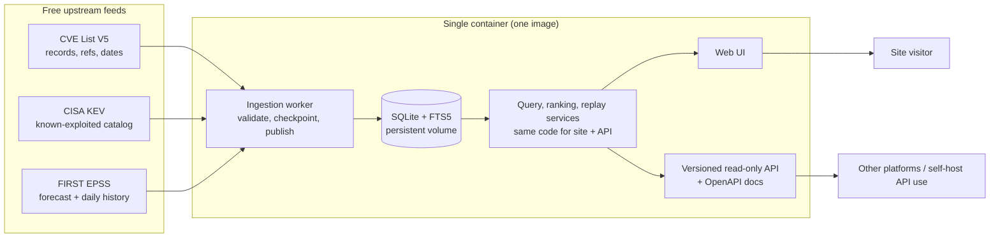
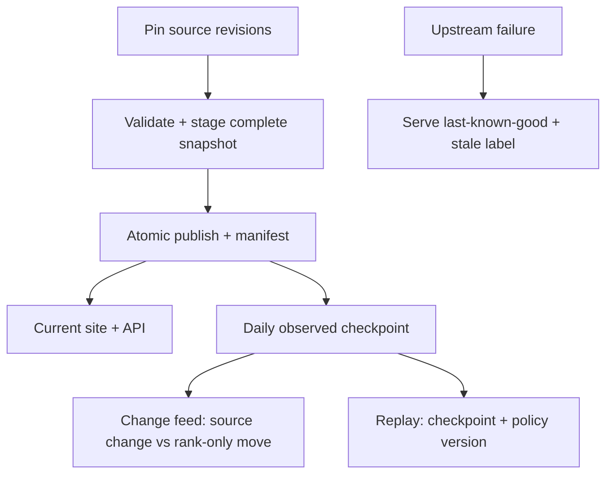

# cve-injector

Public CVE overview with explainable prioritization, searchable descriptions,
official-record links — plus **Change Radar**: what changed, why it matters, and
replayable history. One self-contained Docker image, one container, optional
Compose wrapper, and a versioned read-only API so other platforms (or your own
self-hosted copy) can consume the same data.

> **Status: planning — no application code exists yet.** This README describes the
> approved direction and the evidence behind it. Anything labeled *proposed* still
> needs owner approval in the approval brief before implementation.
> Live project state: `.claude/state/CURRENT_STATUS.md`.

## What this will be

- **Overview** — published-CVE volume charts with explicit date basis and source freshness.
- **Search** — CVE ID and description search with filters, excerpts, and official CVE links.
- **Priority lists** — known-exploited, highest forecast, new critical, rising forecast.
  Separate signals, deterministic ordering, no invented popularity score.
- **Change Radar** — before/after evidence when a record, KEV membership, forecast, or
  list membership changes, with the reason shown.
- **Snapshot replay** — restore a retained daily checkpoint and policy version to see
  what the site showed and why (bounded observed history, no fabricated past).
- **Public read-only API + docs** — the same local snapshots the website reads,
  versioned routes, OpenAPI plus human docs, for external platforms and API-only
  self-hosting. Public writes stay out of scope.
- **Methodology & data status** — sources, notices, ordering rules, coverage gaps, and
  per-source stale/warning states, always visible.

## How it works

Everything runs from **one runtime image as one container**: web UI, local
query/search/ranking, ingestion/scheduling, Radar, and replay. No mandatory
PostgreSQL, Redis, worker image, or host cron. Persistent data lives in a volume;
the image itself stays stateless and secret-free.





- Visitor and API requests **never call upstream directly**; they read accepted
  local snapshots. Only the ingestion worker fetches upstream.
- Each publication pins exact source revisions/dates, observation times, ranking
  policy version, and eligible cohort — replay reuses those, never today's
  corrected records.
- A missing feed keeps serving last-known-good data with a visible per-source
  warning; one failed feed never freezes the others.

## Data sources and why this is feasible

All three core feeds are free to access today (checked 2026-10-24; recheck terms
before launch and before any monetization):

| Source | What we take | Reuse basis |
|---|---|---|
| [CVE List V5](https://github.com/CVEProject/cvelistV5) | Records, descriptions, dates, references, available CNA/ADP metrics | CVE Terms: no-charge reproduction, derivatives, display, distribution — reproduce MITRE copyright designation and license |
| [CISA KEV](https://www.cisa.gov/known-exploited-vulnerabilities-catalog) | Known-exploited membership, date added, catalog metadata | CC0 1.0 for catalog data; third-party links and CISA/DHS marks not covered |
| [FIRST EPSS](https://www.first.org/epss/data) | Daily exploitation probability, percentile, score date, model version | Free, no registration; FAQ asks attribution; services terms permit specified preventative-security uses with notices retained |

Why no paid feed is needed: the site's value is **transparent ordering and
evidence**, not proprietary telemetry. KEV is confirmed-exploitation evidence,
EPSS is a dated forecast, CVSS is supplied severity — three distinct signals,
never multiplied into a fake composite score. Full daily EPSS structurally
validated here: 394,803 unique rows, zero invalid rows under the stated checks;
KEV declared/actual/unique counts matched at 1,756. Those are structural checks,
not model validation or app benchmarks.

Explicitly **not** promised: social popularity, guaranteed nickname search
(e.g. "PHP2Shell"), severity for every CVE, complete unpublished-reservation
counts, or exact parity with any other tracker's projections.

Evidence: `FEASIBILITY.md`, `docs/research/SOURCES.md`,
`docs/DATA_WORKFLOW.md`. Competitor overlap (closest verified: o2CVE) is
documented in `docs/research/COMPETITORS.md`.

## Deployment (planned, not yet implemented)

Normal startup will be:

```bash
docker compose up -d
```

- Production-safe by default: debug off, no source bind mounts, no admin ports,
  non-root runtime, durable volume. Development explicitly selects
  `compose.dev.yaml`; no auto-loaded dev override.
- `setup.sh` exists only if genuine prerequisite checks need it — never a hidden
  installer (no silent packages, sudo, remote downloads, or firewall changes).
- Standalone `docker run` with the same image, volume, and config contract must
  also work; Compose is a wrapper, not a requirement.
- First launch shows an honest initializing state until valid required feeds are
  accepted; restarts resume from checkpoints; backups are database-consistent.

No Dockerfile, Compose file, or image exists yet. See
`.omo/drafts/cve-single-image-deployment.md` for the full acceptance contract.

## Security (planned controls, not yet audited software)

There is no running app to audit; these are requirements the implementation must
meet, per `.claude/SECURITY_STANDARDS.md`:

- Upstream descriptions, references, and archives are **untrusted**: encode output,
  constrain links, strict CSP, no PoC execution, archive traversal/decompression guards.
- Parameterized local queries, validated filters, bounded pages/time/concurrency,
  rate-limited public reads; SSRF allow-lists for the fixed upstream endpoints.
- Public reads are anonymous by design; imports, migrations, and maintenance stay
  private CLI/internal operations — no "skip auth" writes.
- No secrets in images, Git, logs, or URLs; sanitized errors; debug off in release;
  pinned dependencies, minimal non-root image, no Docker socket.
- Public deployment needs explicit HTTPS/certificate/binding setup — Compose alone
  does not create trusted TLS.

## Docs map

| Document | Purpose |
|---|---|
| [`FEASIBILITY.md`](FEASIBILITY.md) | Coverage verdict: what sources support, explicit gaps, readiness gates |
| [`docs/DATA_WORKFLOW.md`](docs/DATA_WORKFLOW.md) | Proposed ingestion, ranking, history, freshness, and acceptance contracts |
| [`docs/research/SOURCES.md`](docs/research/SOURCES.md) | First-party terms, endpoints, fields, live validations, limits |
| [`docs/research/COMPETITORS.md`](docs/research/COMPETITORS.md) | Verified competitor overlap and check limits |
| [`.omo/drafts/cve-approval-brief.md`](.omo/drafts/cve-approval-brief.md) | **Awaiting approval**: bundled design/stack/history/ranking/testing proposal |
| [`.omo/drafts/cve-change-radar.md`](.omo/drafts/cve-change-radar.md) | Planning record: users, gaps, decisions, open questions |
| [`.omo/drafts/cve-change-radar-design.md`](.omo/drafts/cve-change-radar-design.md) | Candidate Evidence Ledger visual direction |
| [`.omo/drafts/cve-single-image-deployment.md`](.omo/drafts/cve-single-image-deployment.md) | Single-image runtime, persistence, lifecycle, parity tests |
| [`.omo/drafts/cve-stack-contract-audit.md`](.omo/drafts/cve-stack-contract-audit.md) | Proposed stack compatibility evidence (not a selected stack) |
| [`.claude/`](.claude/) | Agent rules, security standards, environment guide, task queue, history |

## Pre-dev gates (still open)

1. Approve the bundled brief (design, stack shape, 30-day observed replay,
   ranking policy, tests) — approval authorizes writing the final plan, not code.
2. Create the single execution plan, run its gap analysis, then Momus plus
   independent review against the exact artifact.
3. Only on a later explicit instruction: implement, with TDD, component/browser QA,
   image/container verification, import and search benchmarks.

Host questions are deferred by owner decision; capacity claims require measured
benchmarks, not guesses. Focused local commits continue after verified milestones;
nothing is pushed remotely without a separate request.
