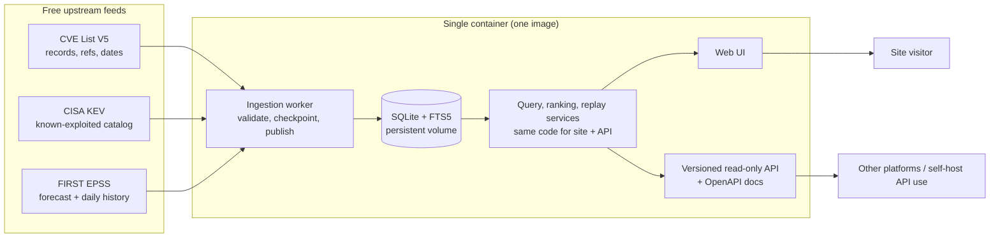
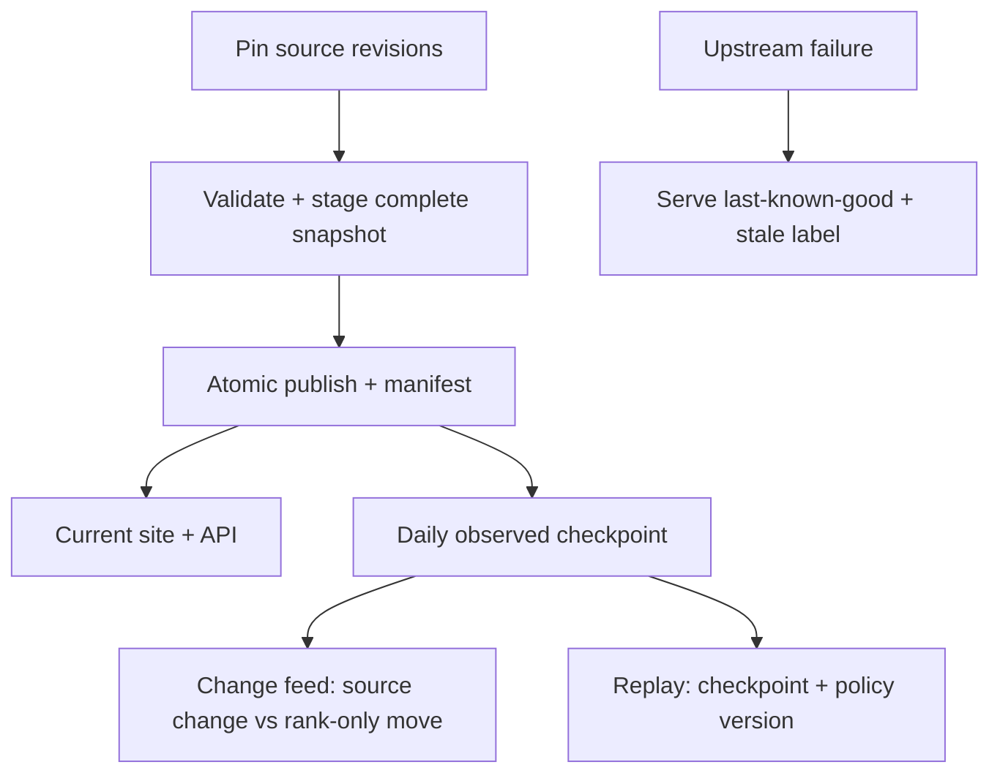

# cve-injector

Public CVE overview with explainable prioritization, searchable descriptions,
official-record links, plus **Change Radar**: what changed, why it matters, and
replayable history. One self-contained Docker image, one container, and a
versioned read-only API so other platforms (or your own self-hosted copy) can
consume the same data.

> **Status: implemented and verified, all 30 build todos plus F1-F4 gates approved.**
> The single-container app, versioned read-only API, Compose setup, and backup
> procedures exist in this tree with evidence under `.omo/evidence/`.

## What it does

- **Overview:** published-CVE volume charts with explicit date basis and source freshness.
- **Search:** CVE ID and description search with filters, excerpts, and official CVE links.
- **Priority lists:** known-exploited, highest forecast, new critical, rising forecast.
  Separate signals, deterministic ordering, no invented popularity score.
- **Change Radar:** before/after evidence when a record, KEV membership, forecast, or
  list membership changes, with the reason shown.
- **Snapshot replay:** a retained daily checkpoint plus policy version shows
  what the site displayed and why (bounded observed history, no fabricated past).
- **Public read-only API + docs:** the same local snapshots the website reads,
  versioned routes, OpenAPI plus human docs. Public writes stay out of scope.
- **Methodology and data status:** sources, notices, ordering rules, coverage gaps, and
  per-source stale/warning states, always visible.

## How it works

Everything runs from **one runtime image as one container**: web UI, local
query/search/ranking, ingestion/scheduling, Radar, and replay. No mandatory
PostgreSQL, Redis, worker image, or host cron. Persistent data lives in a volume;
the image itself stays stateless and secret-free.





- Visitor and API requests **never call upstream directly**; they read accepted
  local snapshots, while only the ingestion worker fetches upstream.
- Each publication pins source revisions/dates, observation times, ranking policy
  version, and eligible cohort; replay reuses those, never today's corrected records.
- A missing feed keeps serving last-known-good data with a visible per-source warning;
  one failed feed never freezes the others.

## Data sources and why this is feasible

All three feeds are free to access today (checked 2026-10-24; recheck terms before launch or monetization):

| Source                                                                   | What we take                                                          | Reuse basis                                                                                                                   |
| ------------------------------------------------------------------------ | --------------------------------------------------------------------- | ----------------------------------------------------------------------------------------------------------------------------- |
| [CVE List V5](https://github.com/CVEProject/cvelistV5)                   | Records, descriptions, dates, references, available CNA/ADP metrics   | CVE Terms: no-charge reproduction, derivatives, display, distribution, reproduce MITRE copyright designation and license     |
| [CISA KEV](https://www.cisa.gov/known-exploited-vulnerabilities-catalog) | Known-exploited membership, date added, catalog metadata              | CC0 1.0 for catalog data; third-party links and CISA/DHS marks not covered                                                    |
| [FIRST EPSS](https://www.first.org/epss/data)                            | Daily exploitation probability, percentile, score date, model version | Free, no registration; FAQ asks attribution; services terms permit specified preventative-security uses with notices retained |

Why no paid feed is needed: the site's value is **transparent ordering and
evidence**, not proprietary telemetry. KEV is confirmed-exploitation evidence,
EPSS is a dated forecast, CVSS is supplied severity. Full daily EPSS
structurally validated here: 394,803 unique rows, zero invalid rows under the
stated checks; KEV counts matched at 1,756. Structural checks only, not model
validation or app benchmarks.

Explicitly **not** promised: social popularity, nickname search (e.g. "PHP2Shell"),
severity for every CVE, unpublished-reservation counts, or parity with other trackers.

Evidence: `FEASIBILITY.md`, `docs/research/SOURCES.md`, `docs/DATA_WORKFLOW.md`.
Competitor overlap (closest verified: o2CVE) is in `docs/research/COMPETITORS.md`.

## Quick start

Prerequisites: Docker with Compose v2, about 12 GB free disk at peak (image
~0.4 GB, persistent CVE checkout cache ~5-6 GB at `<DATA_DIR>/cve-repo`,
database ~4.3 GB plus WAL), and optionally Tailscale for remote access.

```bash
./setup.sh                    # check-only prerequisites (Docker, daemon, compose, port, volume)
docker compose up -d --build  # build cve-change-radar:local and start the single container
docker compose logs -f app    # watch first-boot ingestion progress
```

Ready means: `GET /api/v1/health` returns 200 and `GET /api/v1/status`
shows the first snapshots accepted. KEV/EPSS land in seconds-to-minutes; the
gigabyte CVE List V5 clone takes many minutes, so the site shows an honest
initializing state until then. Live scale here: 395,286 CVEs, 1,756 KEV, 395,249 EPSS.

## Configuration

`.env` is gitignored; `.env.example` is the committed template. Every variable
the app reads is listed there.

| Variable | Default | Meaning |
| -------- | ------- | ------- |
| `APP_ENV` | `production` | Runtime profile: `development`, `staging`, `production` |
| `NODE_ENV` | `production` | Node profile, kept in step with `APP_ENV` |
| `DATA_DIR` | `/data` | Database and snapshot directory inside the container |
| `SCHEDULE_ENABLED` | `true` | `true` imports on boot then refreshes on schedule; `false` imports once, then idles |
| `INGEST_ON_START` | `true` | `false` skips even the first import cycle (worker logs `worker-idle` and parks) |
| `BIND_ADDR` | `127.0.0.1` | Host address the web port binds to |
| `PORT` | `3000` | Host-side web port (container always listens on 3000) |
| `CVE_GIT_TIMEOUT_MS` | `3600000` | CVE List V5 clone timeout in ms (1 hour) |
| `CVE_CLONE_DEPTH` | `1` | `1` is shallow `--depth 1`; `0` means full history |
| `CVE_REPO_DIR` | `<DATA_DIR>/cve-repo` | Persistent CVE checkout cache; first run clones shallow here, refreshes fetch incrementally, never auto-deleted (~5-6 GB) |
| `CVE_REPO_CACHE_RESET` | `false` | `true` wipes the cache and re-clones clean on the next cycle |
| `CVE_MAX_RECORD_BYTES` | `16777216` | Per-record size cap in bytes (16 MiB); oversize records are quarantined |
| `CHECKPOINT_TOP_N` | `500` | Entries kept per view in each daily Change Radar checkpoint |

Compose notes: `compose.yaml` is the production-safe default (single `app`
service, `APP_ENV`/`NODE_ENV=production`, named volume
`cve-change-radar-data` on `/data`, `init: true`,
`restart: unless-stopped`, caps of 4 CPUs / 4 GB). `compose.dev.yaml` is an
explicit opt-in and never auto-loads; no `compose.override.yaml` exists.

## Access

### Local

Default binding stays on loopback: `http://127.0.0.1:3000`, health at
`/api/v1/health`.

### Tailscale

This host's Tailscale IP is `100.124.184.116`. To serve the Mac on the tailnet,
put these lines in `.env` (replace the IP if `tailscale ip -4` reports a new one):

```bash
BIND_ADDR=100.124.184.116
PORT=3100
```

Then restart and check from the Mac:

```bash
docker compose up -d
curl http://100.124.184.116:3100/api/v1/health
```

Open `http://100.124.184.116:3100` in the browser.

### Public HTTPS

Compose does not provide TLS. Public serving needs a reverse proxy or
platform TLS with a real hostname and certificate, keeping
`APP_ENV=production`. Never bind `0.0.0.0` casually; it exposes every
interface.

## Verify it works

Run these against your base URL (`http://127.0.0.1:3000` locally,
`http://100.124.184.116:3100` over Tailscale):

```bash
curl -s http://127.0.0.1:3000/api/v1/health | head -c 300; echo
curl -s http://127.0.0.1:3000/api/v1/overview | head -c 300; echo
curl -s "http://127.0.0.1:3000/api/v1/priority/known-exploited?limit=2" | head -c 300; echo
curl -s "http://127.0.0.1:3000/api/v1/search?q=openssl&limit=2" | head -c 300; echo
curl -s -o /dev/null -w "%{http_code}\n" http://127.0.0.1:3000/
```

Expect: health 200 with an ok/degraded state; overview has non-empty buckets plus a
date basis; known-exploited returns KEV entries; search returns matches with excerpts;
`/` returns 200 (about 4.6 s first load here; API medians run 0.5-3.7 s).

## Operations

Logs: `docker compose logs -f app` shows web plus worker output
(`worker-start` at boot, `source-start` per source per cycle, one
`ingest-cycle` completion line per source, `worker-idle`/`worker-scheduled`
when it parks).

Update vs rebuild: plain `docker compose up -d` starts the existing image
and **never rebuilds**. After source edits, run `docker compose build &&
docker compose up -d`.

Stop and down: `docker compose stop` halts the container; `docker compose down` removes it. Both keep the named volume, so data survives.

Backup: follow `docs/backup-runbook.md` for backup, restore, and upgrade (round-trip verified; incompatible restores are refused with guidance).

Resetting data: `docker compose down -v` deletes the `cve-change-radar-data` volume with all 4+ GB of snapshots. Destructive and irreversible; back up first if the data matters.

## Troubleshooting

- **Port already in use.** Set a free `PORT` in `.env` and rerun
  `docker compose up -d`. `./setup.sh` flags the clash first.
- **Empty site on first boot.** Normal while the CVE clone runs. Find
  `{"event":"source-start","source":"cve"}` in the logs, then wait for its `ingest-cycle` line.
- **Slow first import.** The clone is gigabytes; budget minutes to tens of minutes.
  Raise `CVE_GIT_TIMEOUT_MS` on slow links; keep `CVE_CLONE_DEPTH=1` for fastest boot.
- **Outbound fetches stall (IPv6).** The worker already prefers IPv4. If DNS still
  hangs, set `NODE_OPTIONS=--dns-result-order=ipv4first` and restart.
- **Disk pressure.** Keep ~6 GB free for image, clone, and ~4.3 GB database.
  A full disk fails imports first, so check `df -h` early.
- **Unhealthy container but `/api/v1/health` answers 200.** The web side is fine;
  the worker is likely contending on import. Read its log lines before restarting.

## Development

Dev mode is an explicit second Compose file (hot reload, source bind mounts, Node inspector on loopback):

```bash
docker compose -f compose.yaml -f compose.dev.yaml up
```

Native commands:

```bash
npm ci                  # install dependencies
npm run dev             # local dev server
npm run lint            # eslint
npm run typecheck       # tsc --noEmit
npm test                # vitest suite
npx playwright test     # end-to-end browser tests (tests/e2e)
```

## API

Versioned read-only routes under `/api/v1`. Full shapes live in `openapi/v1.yaml`, with prose guides in `docs/api/`.

| Method + path | Purpose |
| ------------- | ------- |
| `GET /api/v1/health` | Liveness plus readiness state |
| `GET /api/v1/status` | Per-source freshness and warnings |
| `GET /api/v1/overview` | Published-CVE volume buckets with date basis |
| `GET /api/v1/cves` | Paginated CVE records |
| `GET /api/v1/cves/{cveId}` | One CVE record with references |
| `GET /api/v1/search?q=...` | CVE ID and description search |
| `GET /api/v1/priority/{listName}` | `known-exploited`, `highest-forecast`, `new-critical`, `rising-forecast` |
| `GET /api/v1/radar` | Change feed with before/after evidence |
| `GET /api/v1/replay` | Replay a retained checkpoint plus policy version |
| `GET /api/v1/replay/checkpoints` | List available checkpoints |

GET only, no auth, rate limited. Unknown EPSS renders as explicit `null`, never zero. `GET /api/v1/status` reports per-source stale and warning states.

## Security

Implemented controls per `.claude/SECURITY_STANDARDS.md`; F2 code-quality review approved (no suppressions, parameterized SQL, pinned dependencies, no secrets):

- Upstream descriptions, references, and archives are **untrusted**: encoded output, constrained links, strict CSP, no PoC execution, archive guards.
- Parameterized queries, validated filters, bounded pages/time/concurrency, rate-limited reads; SSRF allow-lists for the fixed upstream endpoints.
- Public reads are anonymous by design; imports, migrations, and maintenance stay private CLI/internal operations.
- No secrets in images, Git, logs, or URLs; sanitized errors; debug off in release; pinned dependencies, minimal non-root image, no Docker socket.
- Public serving needs explicit HTTPS/certificate/binding setup. Compose alone does not create trusted TLS.

## Docs map

| Document                                                                                   | Purpose                                                                   |
| ------------------------------------------------------------------------------------------ | ------------------------------------------------------------------------- |
| [`FEASIBILITY.md`](FEASIBILITY.md)                                                         | Coverage verdict: what sources support, explicit gaps, readiness gates    |
| [`docs/DATA_WORKFLOW.md`](docs/DATA_WORKFLOW.md)                                           | Proposed ingestion, ranking, history, freshness, and acceptance contracts |
| [`docs/research/SOURCES.md`](docs/research/SOURCES.md)                                     | First-party terms, endpoints, fields, live validations, limits            |
| [`docs/research/COMPETITORS.md`](docs/research/COMPETITORS.md)                             | Verified competitor overlap and check limits                              |
| [`.omo/drafts/cve-approval-brief.md`](.omo/drafts/cve-approval-brief.md)                   | Approved bundle: design, stack, history, ranking, testing basis           |
| [`.omo/drafts/cve-change-radar.md`](.omo/drafts/cve-change-radar.md)                       | Planning record: users, gaps, decisions, open questions                   |
| [`.omo/drafts/cve-change-radar-design.md`](.omo/drafts/cve-change-radar-design.md)         | Candidate Evidence Ledger visual direction                                |
| [`.omo/drafts/cve-single-image-deployment.md`](.omo/drafts/cve-single-image-deployment.md) | Single-image runtime, persistence, lifecycle, parity tests                |
| [`.omo/drafts/cve-stack-contract-audit.md`](.omo/drafts/cve-stack-contract-audit.md)       | Proposed stack compatibility evidence (not a selected stack)              |
| [`.claude/`](.claude/)                                                                     | Agent rules, security standards, environment guide, task queue, history   |

## Build gates (all done)

1. Bundled brief approval, done (design, stack shape, 30-day observed replay, ranking policy, tests).
2. Single execution plan with gap analysis plus independent review, done (30 todos + F1-F4, 4 review rounds, zero open blockers).
3. Implementation with TDD, component/browser QA, image/container verification, and import/search benchmarks, done (todos 1-30, evidence under `.omo/evidence/`).
4. Final verification, all approved: F1 plan compliance, F2 code quality, F3 browser QA (green, with phone/desktop/keyboard/zoom/reduced-motion evidence), F4 ideal-state fidelity (10/11 outright; the shortfall became tracked todo 31, now complete).
