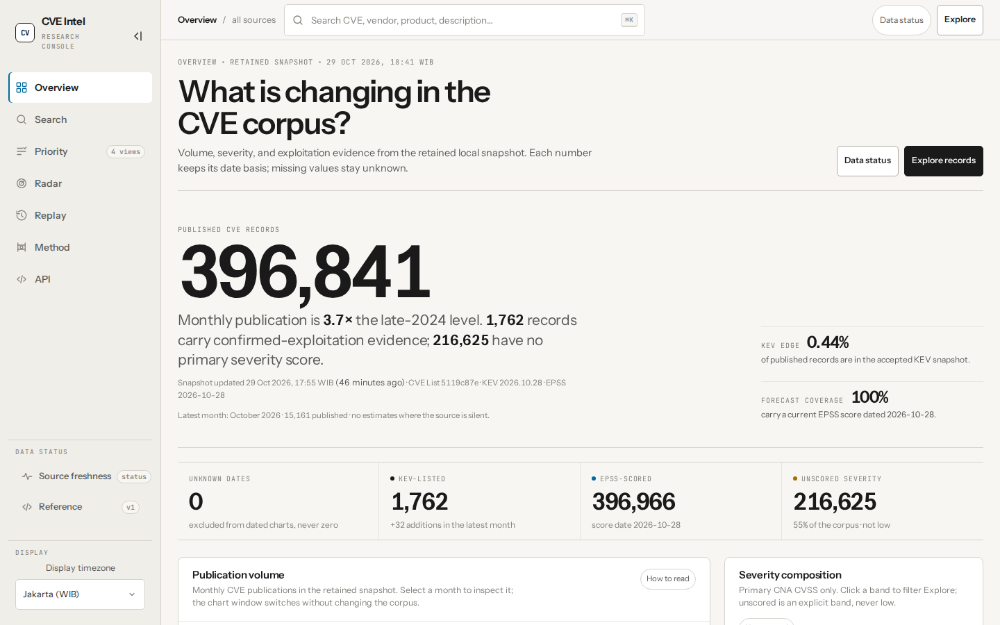
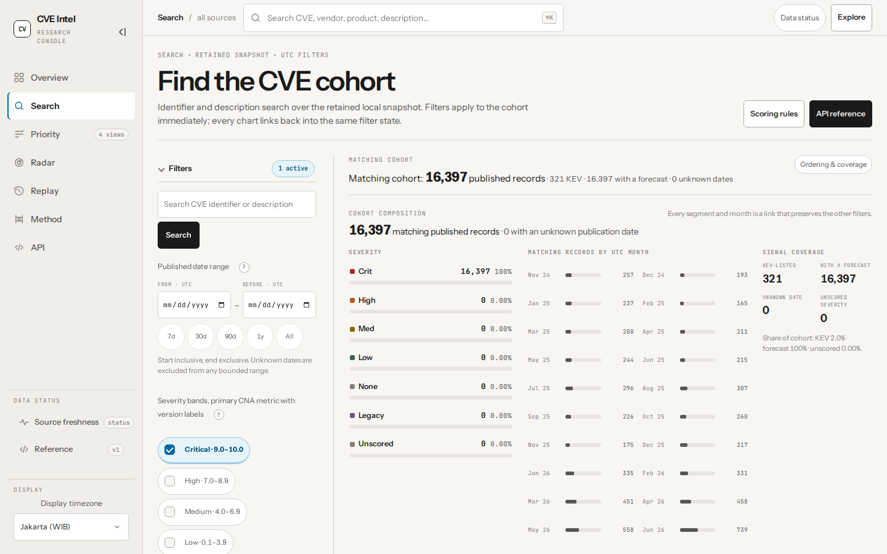
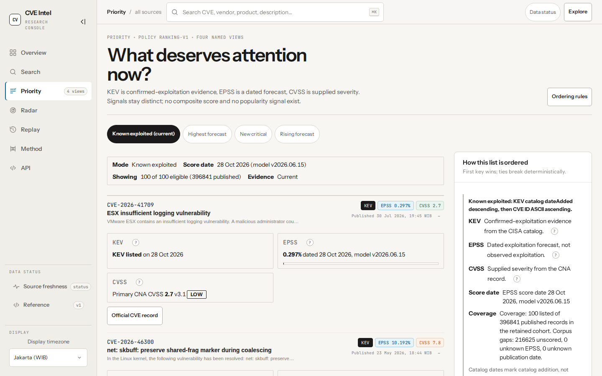
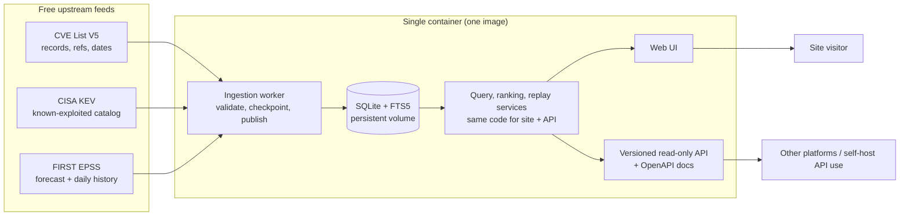
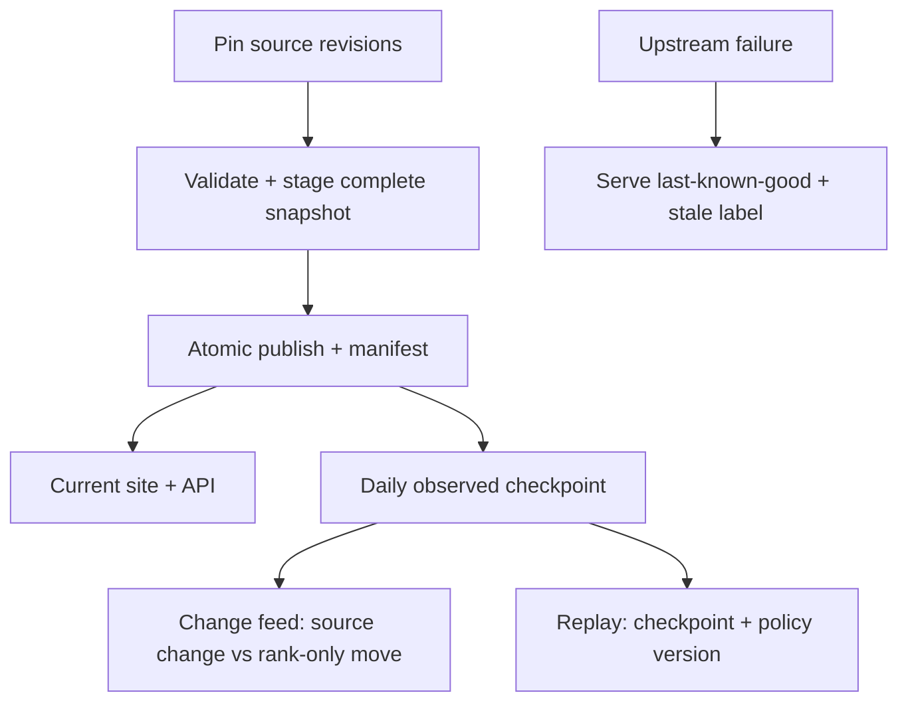

# Kevelry (cve-change-radar)

[](LICENSE)
[](package.json)

**Naming:** **Kevelry** is the public name (repository, wordmark). The
package/image name stays `cve-change-radar` (local folder `cve-injector`);
all three refer to this one app. Internal names were kept stable on purpose
so the live volume and image references never break.

Self-hosted CVE intelligence console with an interactive overview, explainable
prioritization, searchable descriptions, official-record links, plus **Change
Radar** and replayable history. One self-contained Docker image, one container,
and a versioned read-only API so other platforms (or your own self-hosted copy)
can consume the same data.

> **Status: v1 released and serving with scheduled refresh on (CVE + KEV hourly,
> EPSS daily).** 371 unit + 84 Playwright tests green; lint, typecheck, build, and
> secret-scan run on every push via CI. See [Build gates](#build-gates-all-done).





## What it does

- **Overview:** a factual hero, four corpus stats, a 24/12-month volume explorer
  with a focus-month control, a cumulative growth line, a severity donut, a
  log-scale EPSS distribution, KEV rhythm, and an exact severity×EPSS matrix with
  KEV rings and a keyboard inspector. Selecting a month, band, or cell explains
  the cohort and links into Search.
- **Search:** explained filters that auto-apply, quick UTC date presets, a cohort
  composition panel (severity, month, signal coverage), and compact result rows
  with severity, KEV, EPSS, and official-record links.
- **Priority lists:** known-exploited, highest forecast, new critical, rising forecast
  as a compact expandable table. KEV, EPSS, and CVSS remain separate signals with
  definitions, real bars, and timezone-aware dates; no composite score.
- **Change Radar:** before/after evidence when a record, KEV membership, forecast, or
  list membership changes, with the reason shown.
- **Snapshot replay:** a retained daily checkpoint plus policy version shows
  what the site displayed and why (bounded observed history, no fabricated past).
- **Public read-only API + docs:** the same local snapshots the website reads,
  versioned routes, OpenAPI plus human docs. Public writes stay out of scope.
- **Methodology and data status:** pipeline, signal-relationship, and ordering
  diagrams; sources, notices, ordering rules, coverage gaps, and per-source
  stale/warning states, always visible.
- **Global display timezone:** a rail selector (default Asia/Jakarta) re-renders
  every instant; UTC day/month buckets stay explicitly labeled UTC.
- **Methodology explainers:** an interactive ingestion pipeline, a live signal
  coverage diagram, and a worked ordering example that highlights the first
  deciding key for each view.
- **API docs:** a jump index to every topic and endpoint, parameter names resolved
  from shared refs, and an illustrative response body per endpoint.

## Interface

The product is a **Research Console**: a persistent, collapsible 232px rail
(72px collapsed, remembered locally), a sticky command bar (`⌘K` focuses search),
warm paper surfaces, Instrument Sans + JetBrains Mono, and chart-first pages.
The Explore filter rail scrolls independently on desktop; its date control uses
explicit UTC fields plus 7d/30d/90d/1y/All presets. The interaction contract is
deliberate:

- every chart has a takeaway, a "How to read" disclosure, and a data table;
- help glyphs are a 17px inline circle inside a 44px invisible target, never a
  large bordered box;
- hover and keyboard focus show the same exact tooltip with a named denominator;
- selection is reversible (`Escape` or clear) and click-through preserves context;
- severity is never color-only, and unscored is an explicit band, never zero;
- no page overflows at 360px or 200% zoom; standalone targets are 44×44px.

The visual system is documented in [`DESIGN.md`](DESIGN.md). The palette is the
same warm neutral family as before: paper `rgb(247,246,243)`, ink
`rgb(26,26,26)`, rule `rgb(214,211,205)`, accent `rgb(0,106,159)`.

Charts use visx SVG primitives rather than a canvas chart framework, so values
remain in the DOM and CSS variables carry the theme. Fonts are self-hosted in
`public/fonts/` (OFL) with no runtime CDN.

## How it works

Everything runs from **one runtime image as one container**: web UI, local
query/search/ranking, ingestion/scheduling, Radar, and replay. No mandatory
PostgreSQL, Redis, worker image, or host cron. Persistent data lives in a volume;
the image itself stays stateless and secret-free.





- Visitor and API requests **never call upstream directly**; they read accepted
  local snapshots, while only the ingestion worker fetches upstream.
- Each publication pins source revisions/dates, observation times, ranking policy
  version, and eligible cohort; replay reuses those, never today's corrected records.
- A missing feed keeps serving last-known-good data with a visible per-source warning;
  one failed feed never freezes the others.

## Data sources and why this is feasible

All three feeds are free to access today (checked 2026-10-24; recheck terms before launch or monetization):

| Source                                                                   | What we take                                                          | Reuse basis                                                                                                                   |
| ------------------------------------------------------------------------ | --------------------------------------------------------------------- | ----------------------------------------------------------------------------------------------------------------------------- |
| [CVE List V5](https://github.com/CVEProject/cvelistV5)                   | Records, descriptions, dates, references, available CNA/ADP metrics   | CVE Terms: no-charge reproduction, derivatives, display, distribution, reproduce MITRE copyright designation and license      |
| [CISA KEV](https://www.cisa.gov/known-exploited-vulnerabilities-catalog) | Known-exploited membership, date added, catalog metadata              | CC0 1.0 for catalog data; third-party links and CISA/DHS marks not covered                                                    |
| [FIRST EPSS](https://www.first.org/epss/data)                            | Daily exploitation probability, percentile, score date, model version | Free, no registration; FAQ asks attribution; services terms permit specified preventative-security uses with notices retained |

Why no paid feed is needed: the site's value is **transparent ordering and
evidence**, not proprietary telemetry. KEV is confirmed-exploitation evidence,
EPSS is a dated forecast, CVSS is supplied severity. Full daily EPSS
structurally validated here: 394,803 unique rows, zero invalid rows under the
stated checks; KEV counts matched at 1,756. Structural checks only, not model
validation or app benchmarks.

Explicitly **not** promised: social popularity, nickname search (e.g. "PHP2Shell"),
severity for every CVE, unpublished-reservation counts, or parity with other trackers.

Evidence: `FEASIBILITY.md`, `docs/research/SOURCES.md`, `docs/DATA_WORKFLOW.md`.
Competitor overlap (closest verified: o2CVE) is in `docs/research/COMPETITORS.md`.

## Quick start

Prerequisites: Docker with Compose v2, about 12 GB free disk at peak (image
~0.4 GB, persistent CVE checkout cache ~5-6 GB at `<DATA_DIR>/cve-repo`,
database ~4.3 GB plus WAL), and optionally Tailscale for remote access.

```bash
./setup.sh                    # check-only prerequisites (Docker, daemon, compose, port, volume)
docker compose up -d --build  # build cve-change-radar:local and start the single container
docker compose logs -f app    # watch first-boot ingestion progress
```

Ready means: `GET /api/v1/health` returns 200 and `GET /api/v1/status`
shows the first snapshots accepted. KEV/EPSS land in seconds-to-minutes; the
gigabyte CVE List V5 clone takes many minutes, so the site shows an honest
initializing state until then. Live scale here: 396,841 CVEs, 1,762 KEV, 396,966 EPSS.

## Configuration

`.env` is gitignored; `.env.example` is the committed template. Every variable
the app reads is listed there.

| Variable               | Default               | Meaning                                                                                                                   |
| ---------------------- | --------------------- | ------------------------------------------------------------------------------------------------------------------------- |
| `APP_ENV`              | `production`          | Runtime profile: `development`, `staging`, `production`                                                                   |
| `NODE_ENV`             | `production`          | Node profile, kept in step with `APP_ENV`                                                                                 |
| `DATA_DIR`             | `/data`               | Database and snapshot directory inside the container                                                                      |
| `SCHEDULE_ENABLED`     | `true`                | `true` imports on boot then refreshes on schedule; `false` imports once, then idles                                       |
| `INGEST_ON_START`      | `true`                | `false` skips even the first import cycle (worker logs `worker-idle` and parks)                                           |
| `BIND_ADDR`            | `127.0.0.1`           | Host address the web port binds to                                                                                        |
| `PORT`                 | `3000`                | Host-side web port (container always listens on 3000)                                                                     |
| `CVE_GIT_TIMEOUT_MS`   | `3600000`             | CVE List V5 clone timeout in ms (1 hour)                                                                                  |
| `CVE_CLONE_DEPTH`      | `1`                   | `1` is shallow `--depth 1`; `0` means full history                                                                        |
| `CVE_REPO_DIR`         | `<DATA_DIR>/cve-repo` | Persistent CVE checkout cache; first run clones shallow here, refreshes fetch incrementally, never auto-deleted (~5-6 GB) |
| `CVE_REPO_CACHE_RESET` | `false`               | `true` wipes the cache and re-clones clean on the next cycle                                                              |
| `CVE_MAX_RECORD_BYTES` | `16777216`            | Per-record size cap in bytes (16 MiB); oversize records are quarantined                                                   |
| `CHECKPOINT_TOP_N`     | `500`                 | Entries kept per view in each daily Change Radar checkpoint                                                               |
| `PRIORITY_PAGE_LIMIT`  | `100`                 | QA-only display cap for priority views (1–1000)                                                                           |
| `CVE_REPO_URL`         | official repository   | Optional CVE source override (mirror/tests)                                                                               |
| `CVE_REVISION`         | `main`                | Optional CVE revision override                                                                                            |
| `CVE_DB_FILE`          | unset                 | Backfill script: explicit database path                                                                                   |
| `BACKFILL_CHUNK`       | `2000`                | Backfill script: rows per transaction                                                                                     |
| `BETTER_SQLITE3_PATH`  | unset                 | Backfill script: explicit native module path                                                                              |

`.env.example` is a local-development template (`APP_ENV=development`,
`DATA_DIR=./data`); Compose and the image default to production (`APP_ENV=production`,
`DATA_DIR=/data`).

Compose notes: `compose.yaml` is the production-safe default (single `app`
service, `APP_ENV`/`NODE_ENV=production`, named volume
`cve-change-radar-data` on `/data`, `init: true`,
`restart: unless-stopped`, caps of 4 CPUs / 4 GB). `compose.dev.yaml` is an
explicit opt-in and never auto-loads; no `compose.override.yaml` exists.

## Access

### Local

Default binding stays on loopback: `http://127.0.0.1:3000`, health at
`/api/v1/health`.

### Tailscale

This host's Tailscale IP is `100.124.184.116`. To serve the Mac on the tailnet,
put these lines in `.env` (replace the IP if `tailscale ip -4` reports a new one):

```bash
BIND_ADDR=100.124.184.116
PORT=3100
```

Then restart and check from the Mac:

```bash
docker compose up -d
curl http://100.124.184.116:3100/api/v1/health
```

Open `http://100.124.184.116:3100` in the browser.

### Public deployment

The release artifact is **one self-contained image** (`cve-change-radar:local`
from `docker compose build`; publish it to your registry to ship it — Docker Hub
is just `docker tag cve-change-radar:local USER/cve-intel:v1 && docker push
USER/cve-intel:v1`, then pull and `docker run` it anywhere with the env vars
below). It runs
the web UI, the API, ingestion/scheduling, and SQLite/FTS5 in a single
container as non-root, listening on `$PORT` (default 3000) with data in
`/data`. Two supported shapes:

**A. Single image on a serverless platform (e.g. Google Cloud Run).**

```bash
gcloud run deploy cve-intel \
  --image REGION-docker.pkg.dev/PROJECT/REPO/cve-change-radar:TAG \
  --memory 4Gi --cpu 4 --min-instances 1 \
  --no-cpu-throttling \
  --set-env-vars APP_ENV=production,INGEST_ON_START=true,SCHEDULE_ENABLED=true,SITE_URL=https://cve.example.com
```

Platform notes, all load-bearing:

- Keep **one warm instance with CPU always allocated**. Ingestion runs on a
  schedule inside the container; throttled CPU stalls imports and can wedge
  refresh behind timeouts.
- The platform sets `$PORT`; the image honors it. Set `SITE_URL` to the real
  public origin so sitemap and social cards point at it.
- Instance disk is **ephemeral**: on eviction the CVE checkout cache and the
  database are rebuilt from upstream (first boot clones for tens of minutes
  while serving an honest initializing state). For durable history across
  evictions, mount persistent storage (e.g. GCS FUSE on `/data`) instead.
- Give the revision time to finish its first import before judging freshness;
  watch `GET /api/v1/status` (`stale` flags clear per source as each lands).

**B. Recommended VM deployment (Compose + Caddy for TLS).**

Keep the app on loopback and terminate TLS in Caddy (automatic certificates).
An example proxy file ships as `docker/Caddyfile.example`:

```bash
# .env for a public VM behind Caddy
docker compose up -d --build
sudo caddy run --config docker/Caddyfile.example --adapter caddyfile
```

Proxy rules that matter (already in the example):

- Caddy sets `X-Forwarded-For {http.request.remote.host}` (**overwrite**, never
  append): the API rate limit keys on the last forwarded address, so a
  spoofable leftmost value must never survive the edge.
- Firewall the app port off the public internet; expose only 80/443. Never
  bind `0.0.0.0` casually; `APP_ENV` stays `production`.
- Point a cron or timer at the backup runbook (`docs/backup-runbook.md`) and
  an external uptime check at `GET /api/v1/health` before announcing the URL.

## Verify it works

Run these against your base URL (`http://127.0.0.1:3000` locally,
`http://100.124.184.116:3100` over Tailscale):

```bash
curl -s http://127.0.0.1:3000/api/v1/health | head -c 300; echo
curl -s http://127.0.0.1:3000/api/v1/overview | head -c 300; echo
curl -s "http://127.0.0.1:3000/api/v1/priority/known-exploited?limit=2" | head -c 300; echo
curl -s "http://127.0.0.1:3000/api/v1/search?q=openssl&limit=2" | head -c 300; echo
curl -s -o /dev/null -w "%{http_code}\n" http://127.0.0.1:3000/
```

Expect: health 200 with an ok/degraded state; overview has non-empty buckets plus a
date basis; known-exploited returns KEV entries; search returns matches with excerpts.
Measured on the live 395k volume after the final UI quality pass
(2026-10-26): `/` about 0.39 s, `/explore` about 2–4 s on the first uncached
filter combination (up to ~4.5 s immediately after a restart) and about 0.03 s when repeated, `/priority` about 0.19 s,
`/methodology` about 0.02 s, `/api-docs` about 0.05 s, `/radar` and `/replay`
under 0.02 s, and `/api/v1/cves?limit=2` about 1.3 s.

Read-path performance: overview/status/health serve the precomputed aggregate cache
(migration 002), refreshed automatically after every successful import cycle and on
boot when empty. After upgrading the stack on a live volume, refresh once without an
import cycle instead of waiting:

```bash
docker compose exec app env REFRESH_AGGREGATES_ONCE=true node worker.mjs
```

Success GETs carry `Cache-Control: public, max-age=30, s-maxage=60,
stale-while-revalidate=300` plus a strong ETag; repeats with `If-None-Match` return 304. Warm responses for `/`, `/explore`, `/priority`, `/methodology`,
`/api/v1/overview`, `/api/v1/status`, and `/api/v1/cves?limit=2` complete under 1.5 s.

## Operations

Logs: `docker compose logs -f app` shows web plus worker output
(`worker-start` at boot, `source-start` per source per cycle, one
`ingest-cycle` completion line per source, `worker-idle`/`worker-scheduled`
when it parks).

Update vs rebuild: plain `docker compose up -d` starts the existing image
and **never rebuilds**. After source edits, run `docker compose build &&
docker compose up -d`.

Stop and down: `docker compose stop` halts the container; `docker compose down` removes it. Both keep the named volume, so data survives.

Backup: follow `docs/backup-runbook.md` for backup, restore, and upgrade (round-trip verified; incompatible restores are refused with guidance).

Repairing severity data: volumes populated before the importer wrote CVSS
metrics show empty severity filters and "new critical" lists. Repair in place
with `npm run backfill:cvss` (replays metrics from stored record bytes, no
re-clone, safe to re-run); see `docs/DATA_WORKFLOW.md`.

Resetting data: `docker compose down -v` deletes the `cve-change-radar-data` volume with all 4+ GB of snapshots. Destructive and irreversible; back up first if the data matters.

## Troubleshooting

- **Port already in use.** Set a free `PORT` in `.env` and rerun
  `docker compose up -d`. `./setup.sh` flags the clash first.
- **Empty site on first boot.** Normal while the CVE clone runs. Find
  `{"event":"source-start","source":"cve"}` in the logs, then wait for its `ingest-cycle` line.
- **Slow first import.** The clone is gigabytes; budget minutes to tens of minutes.
  Raise `CVE_GIT_TIMEOUT_MS` on slow links; keep `CVE_CLONE_DEPTH=1` for fastest boot.
- **Outbound fetches stall (IPv6).** The worker already prefers IPv4. If DNS still
  hangs, set `NODE_OPTIONS=--dns-result-order=ipv4first` and restart.
- **Disk pressure.** Keep ~12 GB free at peak: image ~0.4 GB, clone cache
  ~5-6 GB, database ~4.3 GB plus WAL. A full disk fails imports first, so
  check `df -h` early.
- **Unhealthy container but `/api/v1/health` answers 200.** The web side is fine;
  the worker is likely contending on import. Read its log lines before restarting.

## Known limitations

- Change Radar and snapshot replay need accumulated daily checkpoints: a fresh
  database shows "history begins" until the first scheduled cycles run. The
  rising-forecast view additionally needs seven days of EPSS snapshots; with
  one snapshot it is explicitly empty rather than guessed.
- Severity comes from CNA-provided CVSS only. Records with no CNA metric show
  "unscored" even when an ADP or NVD score exists; severity filters and the
  new-critical list exclude them by policy.
- Filtered result lists report coverage over the bounded fetch, while
  unfiltered lists report exact cohort counts.
- Snapshot checkpoints retain the top `CHECKPOINT_TOP_N` entries per view
  (default 500) and label them as bounded; they are not a full enumeration.
- The first unfiltered Explore query on a 395k-row volume performs the full cohort
  scan (about 2–4 s, up to ~4.5 s after a restart); identical filter combinations are cached for 60 s.
- The display timezone changes rendering only. Publication buckets stay UTC days or
  months, and every chart says so; it is not a timezone conversion of the data.
- The severity×EPSS matrix scrolls horizontally below about 620px; a visible hint
  states this. Its counts are exact but only available after aggregate cache v3 is
  refreshed (automatic on the next import cycle, or the one-off command above).
- The Explore filter rail scrolls independently on desktop by design; collapsing
  the whole left navigation does not affect the filter form.

## Development

Dev mode is an explicit second Compose file (hot reload, source bind mounts, Node inspector on loopback):

```bash
docker compose -f compose.yaml -f compose.dev.yaml up
```

Native commands:

```bash
npm ci                  # install dependencies
npm run dev             # local dev server
npm run lint            # eslint
npm run typecheck       # tsc --noEmit
npm test                # vitest suite (371 passing, 3 skipped)
npx playwright test     # end-to-end browser tests (84 passing)
npx prettier --write <paths>  # format touched files

`npm run format:check` currently reports pre-existing repository-wide Markdown/test
formatting drift (66 files); use Prettier on touched files. `npm audit` reports three
dev-only findings in the Vitest toolchain; the production image excludes dev
dependencies. Both are tracked under TASK-002.
```

## API

Versioned read-only routes under `/api/v1`. Full shapes live in `openapi/v1.yaml`, with prose guides in `docs/api/` and a browsable reference at [`/api-docs`](/api-docs) (rendered from the spec on each request, so it cannot drift).

| Method + path                     | Purpose                                                                  |
| --------------------------------- | ------------------------------------------------------------------------ |
| `GET /api/v1/health`              | Liveness plus readiness state                                            |
| `GET /api/v1/status`              | Per-source freshness and warnings                                        |
| `GET /api/v1/overview`            | Published-CVE volume buckets with date basis                             |
| `GET /api/v1/cves`                | Paginated CVE records                                                    |
| `GET /api/v1/cves/{cveId}`        | One CVE record with references                                           |
| `GET /api/v1/search?q=...`        | CVE ID and description search                                            |
| `GET /api/v1/priority/{listName}` | `known-exploited`, `highest-forecast`, `new-critical`, `rising-forecast` |
| `GET /api/v1/radar`               | Change feed with before/after evidence                                   |
| `GET /api/v1/replay`              | Replay a retained checkpoint plus policy version                         |
| `GET /api/v1/replay/checkpoints`  | List available checkpoints                                               |

GET only, no auth, rate limited. Unknown EPSS renders as explicit `null`, never zero. `GET /api/v1/status` reports per-source stale and warning states.

## Security

Implemented controls per `.claude/SECURITY_STANDARDS.md`; F2 code-quality review approved (no suppressions, parameterized SQL, pinned dependencies, no secrets):

- Upstream descriptions, references, and archives are **untrusted**: React-escaped output, constrained links, no PoC execution, archive guards. API responses carry a strict JSON CSP; page HTML does not currently set one.
- Parameterized queries, validated filters, bounded pages/time/concurrency, rate-limited reads; SSRF allow-lists for the fixed upstream endpoints.
- Public reads are anonymous by design; imports, migrations, and maintenance stay private CLI/internal operations.
- No secrets in images, Git, logs, or URLs; sanitized errors; debug off in release; pinned dependencies, minimal non-root image, no Docker socket.
- Public serving needs explicit HTTPS/certificate/binding setup. Compose alone does not create trusted TLS.

## Repository

```
app/                    Next.js pages + versioned API routes (app/api/v1/*)
  api-docs/             Browsable reference rendered from openapi/v1.yaml
src/lib/                Domain core: importers, ranking, priority, radar,
                        aggregates, scheduler, backup, database + migrations
src/components/         UI: shell, charts (visx SVG), explore, priority,
                        radar, replay, methodology, ledger primitives
src/worker.ts           Ingestion entrypoint (the only upstream fetcher)
openapi/v1.yaml         Machine API contract (authoritative for /api-docs)
docs/                   Human docs: workflow, research, API guides, runbooks
tests/                  Vitest unit + Playwright browser suites
docker/                 Entrypoint supervisor, Caddy edge-proxy example
scripts/                Backfill + nightly-backup host automation
```

Stack: Next.js 16 App Router, React 19, strict TypeScript, SQLite + FTS5 via
`better-sqlite3`, visx SVG charts, self-hosted Instrument Sans + JetBrains
Mono (OFL). One Docker image, one container, one named volume. Why these
choices: server-rendered pages with zero chart JS framework keep every value
in the DOM (accessible, themeable); a single SQLite file keeps self-hosting
to one volume with WAL-speed reads and `VACUUM INTO` backups; one image
keeps Cloud Run and VM deployments identical.

## Docs map

| Document                                                                                   | Purpose                                                                    |
| ------------------------------------------------------------------------------------------ | -------------------------------------------------------------------------- |
| [`DESIGN.md`](DESIGN.md)                                                                   | Research Console tokens, shell, chart contract, interaction and a11y rules |
| [`FEASIBILITY.md`](FEASIBILITY.md)                                                         | Coverage verdict: what sources support, explicit gaps, readiness gates     |
| [`docs/DATA_WORKFLOW.md`](docs/DATA_WORKFLOW.md)                                           | Implemented ingestion, ranking, history, freshness, and cache contracts    |
| [`docs/research/SOURCES.md`](docs/research/SOURCES.md)                                     | First-party terms, endpoints, fields, live validations, limits             |
| [`docs/research/COMPETITORS.md`](docs/research/COMPETITORS.md)                             | Verified competitor overlap and check limits                               |
| [`.omo/drafts/cve-approval-brief.md`](.omo/drafts/cve-approval-brief.md)                   | Approved bundle: design, stack, history, ranking, testing basis            |
| [`.omo/drafts/cve-change-radar.md`](.omo/drafts/cve-change-radar.md)                       | Planning record: users, gaps, decisions, open questions                    |
| [`.omo/drafts/cve-change-radar-design.md`](.omo/drafts/cve-change-radar-design.md)         | Historical pre-build visual direction; current system is `DESIGN.md`       |
| [`.omo/drafts/cve-single-image-deployment.md`](.omo/drafts/cve-single-image-deployment.md) | Single-image runtime, persistence, lifecycle, parity tests                 |
| [`.omo/drafts/cve-stack-contract-audit.md`](.omo/drafts/cve-stack-contract-audit.md)       | Historical stack audit; selected stack is Next.js/SQLite/visx              |
| [`.claude/`](.claude/)                                                                     | Agent rules, security standards, environment guide, task queue, history    |

## Build gates (all done)

1. Bundled brief approval, done (design, stack shape, 30-day observed replay, ranking policy, tests).
2. Single execution plan with gap analysis plus independent review, done (30 todos + F1-F4, 4 review rounds, zero open blockers).
3. Implementation with TDD, component/browser QA, image/container verification, and import/search benchmarks, done (todos 1-30, evidence under `.omo/evidence/`).
4. Final verification, all approved: F1 plan compliance, F2 code quality, F3 browser QA (green, with phone/desktop/keyboard/zoom/reduced-motion evidence), F4 ideal-state fidelity (10/11 outright; the shortfall became tracked todo 31, now complete).
