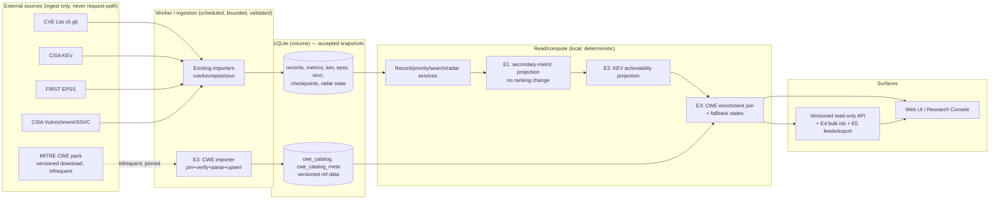
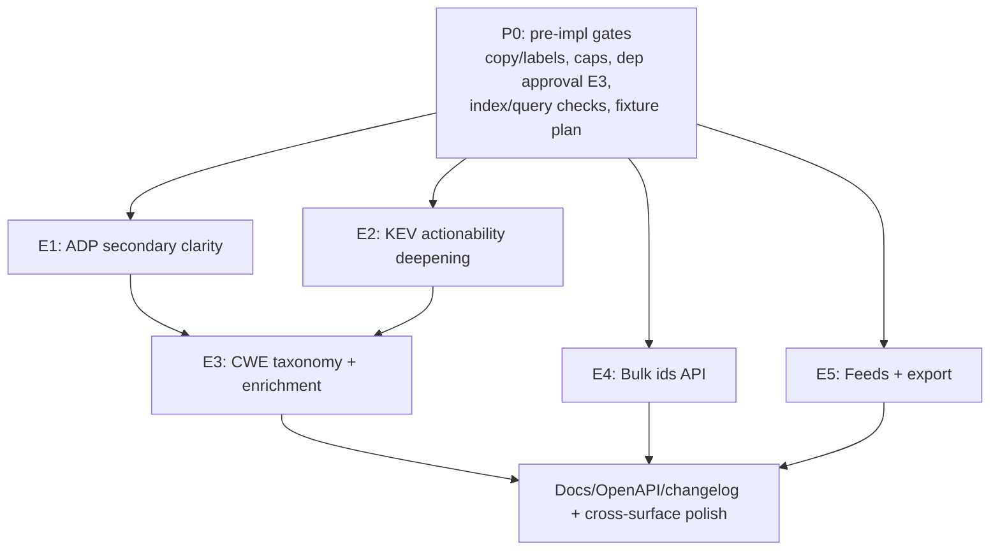

# Kevelry v3 End-to-End Implementation Plan (Sure-Feature Set)

**Status:** planning/spec only (no implementation in this document)  
**Scope of commitment:** features E1–E5 only — each has a verified, free, properly acquirable data source and can be made usable without depending on upstream rate limits at read time.  
**Explicitly out of committed scope:** E6 (OSV/GHSA affected-range intelligence) — gated on unverified terms/rate/bulk-ingest strategy; documented separately as a future milestone, not “sure to implement”.

This plan is written so implementation can proceed epic-by-epic with no guesswork: contracts, data sources, ingestion/rate strategy, data model, module/API/UI interfaces (designed via _design-an-interface_ alternatives + comparison), flows, states, tests, and gates are specified.

---

## 1. Executive summary

### 1.1 Product intent (v3, committed)

Deliver **deeper, citable enrichment and machine-consumable access** on data the app already controls or can ingest as a stable, versioned local dataset — without changing Kevelry’s core guarantees.

### 1.2 Committed epics (sure to implement)

| Epic   | What ships                                                 | Primary user value                                                                                                         |
| ------ | ---------------------------------------------------------- | -------------------------------------------------------------------------------------------------------------------------- |
| **E1** | ADP/secondary CVSS clarity for CNA-unscored context        | Understand unscored records honestly (secondary, labeled) without fake scoring or ranking changes                          |
| **E2** | KEV actionability deepening                                | Act on catalog evidence (required action, ransomware-known, vulnerability name, CWE linkage) with correct scope/provenance |
| **E3** | CWE taxonomy enrichment (names, class, mitigation context) | Turn opaque CWE IDs into readable weakness/mitigation reference context                                                    |
| **E4** | Bulk CVE lookup API                                        | Integrators/watch-style clients fetch many records in one bounded call                                                     |
| **E5** | Snapshot-backed change feeds (RSS/Atom) + bounded export   | Anonymous pull/subscription and bounded data handoff from accepted snapshots                                               |

### 1.3 Non-goals (all epics)

- No composite/hidden scores, no CVSS×EPSS multiplication, no “risk” ranking invention.
- No promotion of ADP/secondary metrics into primary selection or into ranked eligibility (unless a separately versioned, documented ranking-policy change is explicitly approved — **not planned here**).
- No exploit how-to content, no PoC verification claims, no LLM-generated summaries/invented text.
- No accounts, no server-side watchlists, no push/webhooks/email alerts.
- No fabricated values: unknown/missing/unmapped/unavailable stay explicit (never 0, never “low”, never guessed).
- No per-request upstream fetches; no per-request full-corpus/`raw_json` rescans.

---

## 2. Data-source certainty, terms, rate limits, and usability

**Core invariant (makes features usable):** users/read paths **never** depend on live upstream responses. A background ingestion path acquires data within source limits/terms, validates, and publishes to local accepted snapshots/tables; read APIs/UI serve local data and degrade to **last-known-good + explicit stale/unavailable/coverage states** on ingest failure. This is the existing contract (`docs/DATA_WORKFLOW.md`, `README.md`) and applies to every epic.

| Epic   | Source of truth                                                                                                                                                                                                                                                                 | Obtainable & free (now)             | Rate-limit / access strategy                                                                                                                                                                                                                                                                                                                                                                       | Future updates / “still free”?                                                                                                                                                                                                                  | Usability guarantee in this app                                                                                                                          |
| ------ | ------------------------------------------------------------------------------------------------------------------------------------------------------------------------------------------------------------------------------------------------------------------------------- | ----------------------------------- | -------------------------------------------------------------------------------------------------------------------------------------------------------------------------------------------------------------------------------------------------------------------------------------------------------------------------------------------------------------------------------------------------- | ----------------------------------------------------------------------------------------------------------------------------------------------------------------------------------------------------------------------------------------------- | -------------------------------------------------------------------------------------------------------------------------------------------------------- |
| **E1** | **Local retained data already ingested**: `cvss_metrics` (CNA+ADP), record/priority/read paths (`src/lib/cve-import.ts`, `src/lib/ranking.ts`, `app/api/v1/_lib/records.ts`)                                                                                                    | **Yes (no new source)**             | **N/A** (no upstream fetch)                                                                                                                                                                                                                                                                                                                                                                        | Moves with existing CVE/SSVC ingests (already scheduled)                                                                                                                                                                                        | Always available when DB readable; no upstream dependency added                                                                                          |
| **E2** | **Local retained data already ingested**: `kev_entries`, `kev_cwes`, SSVC (`src/lib/kev-import.ts`, `ssvc-import.ts`)                                                                                                                                                           | **Yes (no new source)**             | **N/A**                                                                                                                                                                                                                                                                                                                                                                                            | Moves with existing KEV/SSVC ingests                                                                                                                                                                                                            | Same as E1                                                                                                                                               |
| **E3** | **MITRE CWE downloadable data pack in CSV form** — `CSV.zip` per view from `cwe.mitre.org` ([downloads](https://cwe.mitre.org/data/downloads.html); MITRE publishes both `CSV.zip` and `XML.zip` per view), imported into **local versioned tables**. Public reference dataset. | **Yes, feasible** (public download) | **Low/controlled:** infrequent, scheduled/manual-refresh fetch (e.g. per release cadence, not per request); ingest the **CSV** with the existing RFC4180 parser already used for EPSS (`parseEpssCsv` in `src/lib/epss-import.ts`), pinned by version + hash, size-capped, single-flight, artifact cached on disk/volume. **Never** in request path. **No new production dependency is required.** | Periodic MITRE releases (versioned, not real-time). Public/free availability is historically stable but **not a contractual guarantee we control** → mitigated by pin+cache+last-known-good and explicit “taxonomy unavailable/unmapped” states | Usable offline-from-upstream once loaded; UI/API show mapped names/mitigation from local store or explicit unmapped/stale state (never blank-as-meaning) |
| **E4** | **Local retained records/snapshots**                                                                                                                                                                                                                                            | **Yes**                             | **N/A** upstream; API protected by existing guardrails/rate/concurrency/bounds                                                                                                                                                                                                                                                                                                                     | With snapshots                                                                                                                                                                                                                                  | Deterministic, bounded response from local DB                                                                                                            |
| **E5** | **Local accepted snapshots & Radar/change material** (`checkpoints`, radar diff/read, `src/lib/radar.ts`)                                                                                                                                                                       | **Yes**                             | **N/A** upstream; HTTP cache/conditional GET + existing limits                                                                                                                                                                                                                                                                                                                                     | With snapshots/retention                                                                                                                                                                                                                        | Windowed to retained accepted history; stable when snapshot exists                                                                                       |

**Policy/ops notes (all):** retain attribution/provenance in data and docs where required; recheck upstream terms before material changes; on any ingest failure keep last-known-good and surface stale/error/coverage explicitly. **E6 is excluded** because the hard part is the join: CVE records carry vendor/product strings while OSV keys on ecosystem + package + affected range, so a wrong join would produce “not affected” claims, which is worse than no feature. OSV documents no API rate limits and offers batch queries plus bulk exports ([https://google.github.io/osv.dev/api/](https://google.github.io/osv.dev/api/)), so rate limits are not the blocker.

---

## 3. Contracts and design system constraints (must hold)

### 3.1 Data/ranking contracts

- CNA-primary metric selection unchanged (`docs/DATA_WORKFLOW.md`, `src/lib/ranking.ts`). Every stored CNA/ADP metric preserved/distinguishable.
- No composite score; deterministic ordering; exact-decimal comparisons where specified; malformed input → unknown/ineligible (no throws on hostile data).
- KEV = catalog membership/evidence as stated (dates/fields are catalog facts, not inferred first-exploit time or universal SLA). SSVC/Vulnrichment = CISA-published decision points, never merged into a score.
- `ransomwareKnown`: catalog-stated (Known/Unknown/unstated) — never negated into “no ransomware”.

### 3.2 UX/design contracts (from `DESIGN.md`, `app/ui.css`)

- Research Console: one clear question per surface; charts lead; exact counts + named denominators + visible uncertainty.
- Warm paper tokens (`--ui-*`), Instrument Sans + JetBrains Mono, tabular numerals; light/dark via token assignment only.
- Severity/source/meaning **never color-only** (pair word/symbol/shape/label). “Unscored/unknown/legacy/unmapped” explicit.
- Help glyph = 17px inline circle inside 44px target; hover == keyboard focus tooltip; selection reversible (Esc/clear).
- 360px and 200% zoom without overflow; standalone targets ≥44px; keyboard path for all interactions.

### 3.3 Engineering contracts

- Parameterized SQL only; validate/bound inputs; reuse guardrails (`_lib/guardrails.ts`, `params.ts`, `errors.ts`, `http-cache.ts` patterns).
- No `raw_json`/full-corpus scans per request; indexed/batched reads; preserve aggregate-cache freshness behavior.
- Additive migrations, idempotent backfills/maintenance (`maintenance_runs` pattern), safe on existing volumes; backup/restore discipline unchanged.

---

## 4. Architecture & end-to-end flow (system view)



**Request-path rule:** API/UI read only from `Store` via `Read`. **Ingest-path rule:** `Sources` contacted only by `Ingest` on schedule/manual trigger, with validation, rate/backoff control, and last-known-good on failure.

---

## 5. Design-an-interface: alternatives, comparison, and chosen designs

> Applied per _design-an-interface_: generate radically different shapes, compare on simplicity, generality, implementation efficiency, depth, and correct-use vs misuse — then synthesize. (No parallel sub-agents spawned; alternatives reasoned explicitly and recorded for implementation.)

### 5.1 E1 — Secondary CVSS representation (read/API contract)

**Problem:** expose preserved CNA+ADP metrics for CNA-unscored/ADP-only context without creating a second “primary”, without affecting ranking/eligibility, and without ambiguous client use.

| Option                                                                  | Shape                                                                                                                                                                                                                                                                                                                  | Hides                                                                     | Trade-offs                                                                                                                                                                                                                                                                                                                           |
| ----------------------------------------------------------------------- | ---------------------------------------------------------------------------------------------------------------------------------------------------------------------------------------------------------------------------------------------------------------------------------------------------------------------- | ------------------------------------------------------------------------- | ------------------------------------------------------------------------------------------------------------------------------------------------------------------------------------------------------------------------------------------------------------------------------------------------------------------------------------ |
| **A. Single `cvssSecondary` summary (minimal)**                         | `cvssSecondary: { status: "adp-secondary"\|"legacy-secondary"\|"none", metric?: {source,version,baseScore,vector,provider} } \| null` (one picked “best secondary” by a fixed rule)                                                                                                                                    | Selection among many ADP/secondary metrics; ranking/eligibility untouched | _Simple, misuse-resistant_; callers can’t accidentally re-rank. _Less flexible_ (loses multi-metric/provider detail), but matches “clarity” goal.                                                                                                                                                                                    |
| **B. Full `cvssMetrics[]` mirror (max flexible)**                       | Return every stored metric `{origin,provider,version,baseScore,vector,sourceOrder,isPrimary}`                                                                                                                                                                                                                          | Nothing (raw mirror)                                                      | _General_, supports future UIs; but **easy to misuse** (clients may pick/promote), larger payloads, invites ranking confusion.                                                                                                                                                                                                       |
| **C. Primary-stable + bounded `secondary` block (synthesized, chosen)** | Keep `cvssPrimary` **unchanged**. Add `cvss: { primary: <same semantics>, secondary: { status: "none"\|"present", coverageNote, metrics: Metric[] /* bounded, deterministic order: ADP then other, version-pref, score-desc, sourceOrder */ } }` **and** keep legacy `cvssPrimary` field for compatibility (additive). | Internal storage layout; selection rule; ranking/eligibility logic        | _Deep module:_ one stable projection hides metric grouping/ordering/labeling. Small, explicit surface; bounded; hard to misread as primary because `primary` is untouched and `secondary` is namespaced + `coverageNote` states “context only, not used for ranking/eligibility”. Extensible (add metrics) without breaking callers. |

**Comparison:** B is shallow at the interface (big, ambiguous). A is simple but drops detail we already store. **C chosen**: preserves backward compat, prevents misuse by namespacing, remains bounded/deterministic, and keeps ranking seam closed (`ranking.ts` untouched).

**Chosen interface (record projection, additive):**

```ts
type CvssMetricView = {
  origin: "CNA" | "ADP";
  provider: string | null; // e.g. ADP shortName when known
  version: "4.0" | "3.1" | "3.0" | "2.0" | string;
  baseScore: string; // exact stored decimal text
  vector: string;
  label: "secondary (context only)"; // explicit, non-primary
};

type CvssSecondary = {
  status: "present" | "none";
  coverageNote: string; // e.g. "CNA provided no primary metric; ADP-published metric shown for context only (not used for ranking or eligibility)."
  metrics: CvssMetricView[]; // bounded (cap, e.g. 4), deterministic order
};

// existing cvssPrimary preserved; add:
cvssSecondary: CvssSecondary; // always present for clarity (or null-free object)
```

_Depth:_ `projectCvss(recordMetrics)` (one function/module) owns grouping, ordering, capping, and wording inputs; callers/tests hit this seam. Ranking module remains untouched.

### 5.2 E3 — CWE taxonomy module & join surface

**Problem:** map CWE IDs (from KEV/records/SSVC context) to name/class/mitigation from a versioned, infrequently updated, locally cached dataset — with provenance and explicit unmapped/unavailable states.

| Option                                                           | Shape                                                                                                                                                                                                                                     | Hides                                                                            | Trade-offs                                                                                                                                                                                                              |
| ---------------------------------------------------------------- | ----------------------------------------------------------------------------------------------------------------------------------------------------------------------------------------------------------------------------------------- | -------------------------------------------------------------------------------- | ----------------------------------------------------------------------------------------------------------------------------------------------------------------------------------------------------------------------- |
| **A. Inline columns on fact tables**                             | Denormalize `cwe_name/mitigation` onto `kev_cwes`/views at import                                                                                                                                                                         | Join logic                                                                       | Fast reads but **shallow/wrong seam**: couples volatile taxonomy versions to fact rows, hard to re-version/rollback, bloats updates.                                                                                    |
| **B. Generic “reference data” micro-framework**                  | Pluggable loader/cache for arbitrary datasets                                                                                                                                                                                             | Source specifics                                                                 | Over-general for one dataset now; complexity without leverage (violates depth/YAGNI given single image).                                                                                                                |
| **C. Dedicated `CweCatalog` module + versioned tables (chosen)** | Module owns: `ensureCatalog()` (status), `resolve(ids[]) -> Map<id, ResolvedCwe>`, `meta()` (version/hash/date/source/status). Tables: `cwe_catalog_meta` (singleton/versioned rows) + `cwe_entries` (+ optional mitigation table/field). | Fetch/verify/parse, storage layout, caching, version pinning, fallback selection | _Deep:_ one interface for read path; importer is the only writer. Easy to test with fixtures, easy to reason about last-known-good, re-versionable without touching fact tables. Deterministic joins, bounded payloads. |

**Chosen interface (read seam):**

```ts
type CweCatalogStatus = "ready" | "stale" | "unavailable" | "empty";
type CweRef = {
  id: string; // normalized "CWE-###"
  status: "known" | "unmapped" | "taxonomy-unavailable";
  name?: string;
  abstraction?: string; // e.g. Class/Base/Variant (as published)
  summary?: string; // short description, bounded
  mitigation?: string; // bounded reference text, when present
  url: string; // canonical https://cwe.mitre.org/data/definitions/<n>.html
};
type CweCatalogMeta = {
  status: CweCatalogStatus;
  version: string | null;
  sourceHash: string | null;
  retrievedAt: string | null;
  source: string;
};

interface CweCatalogReader {
  meta(): CweCatalogMeta;
  resolve(ids: readonly string[]): Map<string, CweRef>; // deterministic, no throw; unknown id -> unmapped
}
```

_Ingestion seam (worker-only):_ `loadPinnedOrRefreshCweCatalog(env, fs, db) -> {status, meta}` with single-flight, checksum verify, atomic publish, last-known-good retention. _Depth:_ parser/normalizer/versioning hidden behind `resolve/meta`.

### 5.3 E4 — Bulk CVE lookup API

**Problem:** fetch N records in one call, bounded and deterministic, compatible with existing single-record/list semantics and guardrails.

| Option                                             | Shape                                                                                                                    | Hides                                 | Trade-offs                                                                                                                                                                      |
| -------------------------------------------------- | ------------------------------------------------------------------------------------------------------------------------ | ------------------------------------- | ------------------------------------------------------------------------------------------------------------------------------------------------------------------------------- |
| **A. Extend `GET /api/v1/cves?ids=` (rejected)**   | Mode switch on the list route: when `ids` is present the same route returns a different envelope and a `coverage` object | Batch load/dedupe/order/miss handling | **Rejected:** one route with two envelopes; the `coverage` key is reused with different semantics (eligible cohort vs requested/returned/missing), a misuse hazard for clients. |
| **B. `POST /api/v1/cves/batch` body**              | JSON body `{ids:[]}`                                                                                                     | —                                     | **Rejected:** a POST body breaks the read-only, cacheable GET convention for what is a pure read; adds body parsing/CSRF-ish surface.                                           |
| **C. Dedicated `GET /api/v1/cves/batch` (chosen)** | Separate sub-route with its own envelope                                                                                 | Batch load/dedupe/order/miss handling | **Chosen:** each route keeps one meaning; the small routing/boilerplate cost buys an unambiguous contract.                                                                      |

**Comparison:** A was rejected because a mode switch on `/api/v1/cves` gives one route two envelopes and reuses the `coverage` key with different semantics (eligible cohort vs requested/returned/missing), which is a misuse hazard. B was rejected because a POST body breaks the read-only GET/cacheable convention. **C is chosen** so each route keeps one meaning.

**Chosen interface (HTTP):**

- `GET /api/v1/cves/batch` with required `ids` (comma-separated, trimmed) — one canonical encoding, no repeated-param form.
- **Constraints:** `1 <= unique valid ids <= 50` (bounded well under URL/IN-clause/response budgets); each matches `CVE_ID_RE`; duplicates removed preserving first-seen order.
- **Known conflicting params are rejected, unknown params are ignored:** the list/search params besides `ids` (`cursor`, `severity`, `kev`, `epss`, `exploit`, `publishedStart`, `publishedEnd`, `limit`, `vendor`, `q`) are **rejected by name** with `400 BAD_REQUEST`; any other unknown parameter is ignored, because it has no documented meaning on this route to conflict with.
- **Response:** `200 { data: CveItem[], resolution: { requested, returned, missingIds }, provenance: {...} }` where `data` is in requested-dedupe order and `missingIds` lists requested-not-found/rejected-by-visibility records; `provenance` same as other v1 responses. No `pagination` object and **no `coverage` key** on this route.
- **Errors:** `400 BAD_REQUEST/BAD_ID` for invalid/too many/conflicting params; standard `429/500` envelopes.
- **Caching:** same `cachedOkResponse`/ETag/Cache-Control discipline (seed over the canonical sorted id set).

_Depth:_ reuses `loadFullRecords`, `toCveItem`, `buildProvenance`, `cachedOkResponse` — route orchestrates validation + shaping only.

### 5.4 E5 — Change feeds & bounded export

**Problem:** anonymous, pull-based consumption of accepted changes and bounded handoff of filtered result sets — snapshot-backed, windowed, cacheable.

| Option                                                               | Shape                                                    | Hides                                                                                                              | Trade-offs                                                                         |
| -------------------------------------------------------------------- | -------------------------------------------------------- | ------------------------------------------------------------------------------------------------------------------ | ---------------------------------------------------------------------------------- |
| **A. Feeds as `/api/v1/radar/feed.(xml                               | atom)`+ export via`format=` on existing list endpoints** | `GET /api/v1/radar/feed.xml` (RSS 2.0) and/or `.atom`; `GET /api/v1/search?…&format=csv` / `format=json` (bounded) | Snapshot selection, windowing, serialization, column mapping                       | Reuses existing query/validation/filter semantics; few new concepts; export stays bounded by existing caps. |
| **B. Dedicated `/api/v1/export/*` and `/api/v1/feeds/*` namespaces** | Separate resource tree                                   | —                                                                                                                  | Clear, but more routes/surface to maintain; export would duplicate filter parsing. |
| **C. “Dump snapshot” endpoint**                                      | Download whole cohort                                    | —                                                                                                                  | **Rejected:** unbounded, violates size/perf/contract expectations.                 |

**Chosen (synthesized, A-leaning):**

- **Feeds:** `GET /api/v1/radar/feed.xml` (RSS 2.0, primary) and `GET /api/v1/radar/feed.atom` (Atom 1.0) — snapshot-backed from retained checkpoints/radar events; query params subset: `since` (bounded by retention), `kind`, `cveId`, `limit` (capped, default small e.g. 50, max e.g. 200). Each item: stable `<guid>`/`<id>` = `eventId` (or deterministic composite), `<pubDate>`/`<updated>` = observedAt/checkpointDate, title/summary factual (CVE, kind, before→after fields) — **no invented prose**, link to canonical record/UI, sourceRevision in description/extension; channel/feed metadata includes provenance window and “accepted snapshot, not live upstream”. `Content-Type: application/rss+xml` / `application/atom+xml`, Cache-Control/ETag/Last-Modified aligned to snapshot seed.
- **Export:** `format=csv|json` (default current behavior/json response when absent) on **bounded, already-paginated** list endpoints that naturally produce row sets: minimally `GET /api/v1/search` and selected priority/list endpoints as specified (e.g. `/api/v1/cves` list, priority) — **same filters/sort/pagination/caps apply**, export serializes the **current page/result set** (not unbounded). CSV: stable documented column order, header row, explicit empty handling for nulls — **no `#` prefix rows**, the file is a header row plus data rows only; spreadsheet and SQL importers would read such rows as data. Provenance and coverage stay in the JSON export envelope and in the UI next to the export control. JSON export = existing envelope (or `{data,provenance,coverage}`) with explicit content-disposition filename.
- **UI affordances:** “Subscribe” (RSS/Atom links) on Radar view; “Export CSV/JSON” on Explore/Search and applicable list views — real links/buttons, 44px targets, disabled with explanation when no rows/over constraints.

_Depth:_ serializer modules (`radarFeed`, `csvExport`) hide formatting details; routes reuse existing query parsing, data fetch, and bounds.

---

## 6. Epic E1 — ADP/secondary CVSS clarity (end-to-end)

### 6.1 Goal & user questions

- “Is this record really unscored, or is there a non-primary (ADP/secondary) metric I can read for context?”
- “How much of the corpus is CNA-unscored vs has secondary-only context?”

### 6.2 Scope / non-goals

- **In:** labeled secondary metric projection, counts/denominators, API + UI surfacing, docs.
- **Out:** any ranking/order/eligibility change, any merge/promotion, any new upstream.

### 6.3 Data & storage

- **Source:** local `cvss_metrics` + existing record fields (already populated by CVE import/backfill).
- **Schema/migration:** **none expected**. Pre-impl check: confirm `provider` and needed columns present (importer already additive per `DATA_WORKFLOW.md`); if any query needs index for a _new_ filter only, add additive index with measured plan. No backfill required.

### 6.4 Backend/module design (deep seam)

- **New/extended pure module (suggested):** `src/lib/cvss-projection.ts` (or colocated) — `projectSecondaryCvss(metrics, primary): CvssSecondary` (deterministic, bounded, no IO). `selectPrimaryCvss`/ranking untouched.
- **Read integration:** `app/api/v1/_lib/records.ts` (and any shared row mappers) attaches `cvssSecondary` alongside existing `cvssPrimary`/`hasAdp`; list loaders must not add `raw_json` reads.

### 6.5 API (additive, v1-compatible)

- **Affected:** `GET /api/v1/cves`, `GET /api/v1/cves/{cveId}`, search/priority/radar/replay payloads that embed CVE items — **add** `cvssSecondary` (object, never ambiguous) while preserving `cvssPrimary` exactly.
- **Docs:** update `docs/api/cves.md`, `search.md`, priority/radar/replay item schemas as applicable, and `openapi/v1.yaml`.
- **Coverage:** where meaningful (overview/lists), include breakdown counters additive to existing `coverage` (e.g. `secondaryOnly` / `unscoredNone`) — finalize names to avoid breaking consumers; if added, document and null-safe.

### 6.6 UI design (Research Console)

- **Overview (`app/page.tsx`, `components/overview/StatStrip.tsx`):** keep “Unscored severity” stat; add subnote `X with ADP-published secondary (context) · Y with no published metric` with denominator = unscored cohort (or corpus segment) and “not low” retained. HelpTip explains “secondary, not used for ranking/eligibility”.
- **Rows/lists (priority/search/explore/radar/replay summaries):** when `cvssPrimary` unknown/adp-only/legacy as today, render compact secondary chip: mono score + version + `ADP`/provider label + word “secondary (context)”. No severity-band promotion; use neutral/unknown-consistent styling tokens, not critical/high color. **Superseded by §15.1.2:** the compact secondary chip on list rows is not implemented — secondary CVSS renders in the detail/expanded block only.
- **Detail/expanded:** “Severity metrics” block: **Primary** (existing, labeled “CNA primary, worst CNA-provided scenario” per policy) and **Secondary (context only)** list (each: origin/provider, version, base, vector, copyable vector text) or explicit “No CNA or ADP metric published”.
- **States:** `present` | `none` | `not-loaded` (should not occur). Each shows text.
- **A11y/interaction:** chips focusable where interactive (tooltip), 44px targets, contrast in both themes, keyboard parity.

### 6.7 Flows

1. **Read:** request → route validates → local DB batched read (metrics) → `projectSecondaryCvss` + existing primary → serialize → cache headers/ETag.
2. **User:** sees unscored count → drills into record → reads “Primary: unscored” + “Secondary (ADP, context only): 7.5 (3.1)”.

### 6.8 Edge cases

ADP-only; multiple ADP metrics; CNA+ADP; legacy-only; v4/v3/v2 mix; malformed stored values (already rejected) → never display as valid; missing provider → show “ADP/provider not specified”.

### 6.9 Tests & acceptance

- **Unit:** projection ordering/capping/labels/status matrix; ranking outputs identical before/after (golden).
- **API:** response shape/back-compat, additive fields, deterministic order.
- **UI (Playwright + component):** overview subnote/denominators, chip text+tooltip, detail block, dark/360px/200% zoom, keyboard focus.
- **DoD:** no raw_json scan added; docs/OpenAPI/changelog updated.

---

## 7. Epic E2 — KEV actionability deepening (end-to-end)

### 7.1 Goal & user questions

- “What does CISA require for this KEV entry, and what catalog flags apply (ransomware-known)?”
- “Which named vulnerability is this catalog entry tracking?”

### 7.2 Scope / non-goals

- **In:** clearer, provenance-labeled surfacing of `requiredAction`, `vulnerabilityName`, `ransomwareKnown`, and CWE IDs (as IDs/links now, enriched names via E3); optional deterministic filters only if cheap/indexed.
- **Out:** inferring “no ransomware”, inventing deadlines/actions, treating due date as universal SLA, duplicating due-soon view logic.

### 7.3 Data & storage

- **Source:** `kev_entries` (`due_date`, `required_action`, `vulnerability_name`, `ransomware_known`), `kev_cwes`, SSVC records.
- **Schema:** **no new tables expected**. Pre-impl: verify indexes for any added filter (e.g. partial/index on `ransomware_known` or `due_date` already exists per migrations); add additive index only if query plan requires.

### 7.4 Backend/module & API

- **Projection:** extend KEV enrichment block in `records.ts`/mappers to a stable, explicit shape:
  ```ts
  kev: {
    listed: boolean;
    dateAdded: string|null;                 // catalog dateAdded
    dueDate: string|null;                   // catalog remediation due date (federal context)
    requiredAction: string|null;
    vulnerabilityName: string|null;
    ransomwareUse: "known"|"unknown"|"unstated"; // from catalog; never "none"
    cwes: string[];                          // normalized CWE IDs
  }
  ```
  (Map existing fields; preserve back-compat aliases if already exposed — additive.)
- **Filters (optional, only if accepted):** `ransomware=known|unknown|any` and/or `hasDueDate=true` — parsed in `params.ts`, applied in bounded SQL with indexes, reflected in coverage/denominators and docs. **Default plan:** implement display-first; add filters only with proven index + UX need (record decision in impl PR/commit notes).
- **Defensive parsing:** tolerate missing/new KEV/Vulnrichment fields and format variance (keep existing guards; add fixtures).

### 7.5 UI design

- **Priority/detail/inspectors (and graph inspector where KEV shown):** “KEV (CISA catalog)” signal block with labeled rows: _Listed_, _Date added (catalog)_, _Due date (catalog, federal context)_, _Required action_ (text, wrapped, source-labeled), _Ransomware campaign use_ = `Known (catalog)` / `Unknown (catalog)` / `Not stated`, _Catalog name_ if present, _CWEs_ as mono chips linking to CWE (and enriched name when E3 ready).
- **Copy/HelpTip:** state scope plainly (catalog evidence, not first exploit, not universal SLA). No alarmist color-only states; due-soon/overdue grouping remains as today, labeled.
- **States:** each field renders `not provided`/hidden-per-field rule consistently (never misleading blank).
- **A11y/layout:** within existing expandable rows/panels, 44px targets, readable at 360px/200%, dark tokens.

### 7.6 Flows & edge cases

- Read local → project KEV block → render. Edge: null/empty strings, `ransomwareKnown` 0/1/null mapping, malformed due date (treat invalid as not provided/display raw only if safe — prefer null+coverage honesty), very long `requiredAction` (wrap/collapse).

### 7.7 Tests

Unit mapping (0/1/null, missing fields), API contract/back-compat, Playwright: labels/scope text present, null handling, no “no ransomware” phrasing.

---

## 8. Epic E3 — CWE taxonomy enrichment (end-to-end)

### 8.1 Goal & user questions

- “What does CWE-94 mean, and what mitigations does the taxonomy recommend (as reference)?”
- “Which weakness classes recur in this cohort/record?”

### 8.2 Scope / non-goals

- **In:** versioned local CWE catalog, deterministic ID→name/abstraction/summary/mitigation mapping, provenance & staleness, API/UI surfacing.
- **Out:** exploit guidance, auto-triage, claiming coverage for records without CWE, real-time sync.

### 8.3 Data source & ingestion (rate-safe, free)

- **Source:** MITRE CWE downloadable/versioned pack (public). Treat as **reference dataset**, not a live feed.
- **Acquisition:** infrequent job (scheduled, e.g. weekly/monthly check, and/or manual operator trigger/CLI) — **not** per request. Steps: resolve pinned/release `CSV.zip` artifact → HTTP fetch with timeout/backoff; skip download if cached version/hash unchanged (conditional/compare) → verify checksum/size bounds → **bounded unzip** (explicit extracted-size/entry-count cap; reject oversize) → parse the CSV with the existing RFC4180 parser (`parseEpssCsv` in `src/lib/epss-import.ts`, reused for CWE rows) offline → atomic publish. Single-flight to avoid duplicate work. **No new production dependency:** CSV ingest reuses the parser already shipped for EPSS.
- **Failure handling:** retain previous accepted catalog (last-known-good), record `status=stale|unavailable` + error (sanitized) in meta; readers continue serving last-known-good; UI shows “taxonomy stale/unavailable (last: <version/date>)”.
- **Terms/provenance:** store `source`, `version`, `sourceHash`, `retrievedAt`, `license/attribution note` as applicable in meta/docs; recheck on updates. (Stable public reference; no per-user rate pressure.)

### 8.4 Data model & migration (additive)

- **`cwe_catalog_meta`** (1+ rows / current pointer): `id`/`current`, `version TEXT`, `source TEXT`, `source_hash TEXT`, `retrieved_at TEXT`, `status TEXT`, `record_count INTEGER`, `notes TEXT`.
- **`cwe_entries`**: `cwe_id TEXT PRIMARY KEY` (normalized `CWE-\d+`), `name TEXT`, `abstraction TEXT NULL`, `status TEXT NULL` (e.g. Draft/Stable/Deprecated as published), `summary TEXT NULL`, `mitigation TEXT NULL` (bounded/truncated at ingest with “truncated” marker if needed), `version TEXT`, `updated_at TEXT`.
- **Indexes:** PK on `cwe_id`; optional none else needed (point lookups). Bounded row count (CWE catalog scale, small).
- **Migration:** e.g. `009_cwe_catalog.up/down.sql` (number finalized at impl). No changes to fact tables. Idempotent upsert on (re)load.

### 8.5 Backend/module design

- **`src/lib/cwe-catalog.ts` (reader, deep):** `getCweCatalogMeta(db)`, `resolveCweIds(db, ids[])` (batched `IN` over unique normalized IDs) → `CweRef` with `known|unmapped|taxonomy-unavailable`. Purely local, deterministic, never throws on bad IDs.
- **`src/lib/cwe-import.ts` (writer/worker-only):** `refreshCweCatalog(...)` — download/verify/parse/normalize/upsert/publish meta. The ingest reads MITRE's `CSV.zip` with the existing RFC4180 CSV parser already used for EPSS (`parseEpssCsv` in `src/lib/epss-import.ts`), so no new production dependency and no XML/XSD parsing step is introduced; keep a bounded unzip (entry count, uncompressed size cap) and a version/hash pin.
- **Normalization:** accept `CWE-79`, `79` (normalize), dedupe; reject/mark invalid IDs as unmapped.

### 8.6 API (additive)

- Where CWE IDs are surfaced (CVE detail, KEV enrichment, graph evidence/groups/summaries), add enriched objects alongside raw IDs for back-compat:
  ```ts
  cwes: string[]; // existing
  cweDetails: CweRef[]; // additive, aligned order/unique
  cweCatalog: { status, version, retrievedAt } // context when relevant (detail/graph payloads) or global in provenance-adjacent meta
  ```
- Update `docs/api/cves.md`, `graph.md`, relevant schemas, OpenAPI. No new upstream in request.

### 8.7 UI design

- **Chip/label:** `CWE-94 · Improper Control of Generation of Code ('Code Injection')` (name when known) + external link icon semantics (link to canonical CWE URL). Mono ID, readable name.
- **Mitigation (reference):** disclosure/expand or detail-panel text “Mitigation (reference, MITRE CWE <version>)” — bounded, plain language, **not** exploit guidance. HelpTip: “Weakness classification and published mitigation guidance for context; applicability depends on the product.”
- **States:** `known` (name±mitigation), `unmapped` (“CWE ID published; not found in loaded catalog”), `taxonomy-unavailable/stale` (banner/note at block level with last-known-good version/date). Never blank.
- **Surfaces:** record detail, KEV blocks, priority inspectors, **Graph** nodes/edges/groups/inspector (`GraphView.tsx`) — replace raw-ID-only labels where space allows, keep ID always visible.
- **A11y:** expand/collapse keyboard operable, focus managed, links named, 360px/zoom safe (wrap, no overflow).

### 8.8 Flows

- **Ingest (infrequent):** trigger → fetch-if-changed → verify → parse → upsert → publish meta (or mark stale on failure, keep old).
- **Read:** resolve IDs in batch with records/graph payload build → attach `cweDetails` → render with state.

### 8.9 Edge cases

Deprecated/withdrawn IDs (show status if available), unknown IDs, catalog empty/unavailable, very large mitigation (truncate), duplicate IDs across sources.

### 8.10 Tests & ops

- Parser/normalizer fixtures (small real-shaped sample), resolve map (known/unmapped/unavailable), ingest idempotency & last-known-good on failure, API shape, UI states/links/a11y, perf (batch resolve, no N+1).

### 8.11 Pre-implementation gates (must close)

- **(a)** Pin the exact `CSV.zip` pack URL + versioning strategy (how a new release is detected, verified, and adopted), plus bounded-unzip size/entry caps.
- **(b)** Record attribution/terms text in `docs/research/SOURCES.md` (or equivalent).
- CSV ingest **reuses the existing RFC4180 parser** (`parseEpssCsv`), so **no new dependency approval is required** — the former “XML parse dependency” gate is closed.

---

## 9. Epic E4 — Bulk CVE lookup API (end-to-end)

### 9.1 Goal

Allow clients (and internal consumers like watch) to retrieve many records in one deterministic, bounded request.

### 9.2 API contract (chosen)

- **Route:** `GET /api/v1/cves/batch` (dedicated route; `/api/v1/cves` keeps its list meaning and `coverage` semantics).
- **Params:** `ids` required, comma-separated CVE IDs. Trim elements; drop empties; dedupe preserving first-seen requested order.
- **Validation:** every element must match `CVE_ID_RE`; `1..50` unique ids (cap **50**). Known conflicting params are rejected; unknown params are ignored — the list/search params (`cursor`, `limit`, `severity`, `kev`, `epss`, `exploit`, `publishedStart`, `publishedEnd`, `vendor`, `q`) fail with `400 BAD_REQUEST` naming the param, while any other unknown parameter is ignored.
- **Response 200:**
  ```json
  {
    "data": [ /* CveItem, requested-dedupe order */ ],
    "resolution": { "requested": N, "returned": K, "missingIds": ["CVE-..."] },
    "provenance": { ...same shape as other v1 responses... }
  }
  ```
  No `pagination` object and no `coverage` key. Records not found or not publicly visible under current rules appear in `resolution.missingIds` (never fabricated). Ordering deterministic.
- **Errors:** `400 BAD_ID` (an element fails `CVE_ID_RE`) / `400 BAD_REQUEST` (missing, empty, repeated, too many, or a known conflicting param); standard `429`/`500`.
- **Cache/headers:** `cachedOkResponse` with the ETag seed over the canonical sorted id set; security/rate headers as today.

### 9.3 Implementation design

- Reuse `loadFullRecords` (already chunked/batched), `toCveItem`, `buildProvenance`, `cachedOkResponse`, guardrails. No new DB tables.
- Do **not** reuse the list route's `coverage` key: bulk counts live under `resolution` only, so `coverage` keeps one meaning (eligible cohort).
- Canonicalize the id set for the cache seed: sorted unique ids (deterministic).

### 9.4 Docs & clients

- Update `docs/api/cves.md`, `docs/api/README.md`, `openapi/v1.yaml`, `app/api-docs` examples/curl. Note watch can adopt later (optional, not required).

### 9.5 Tests

Valid set, duplicates, order preservation, missing/rejected mix, over cap, invalid ID, conflicting params, cache/ETag behavior, parity with single `GET /api/v1/cves/{id}` for same records.

---

## 10. Epic E5 — Snapshot-backed feeds & bounded export (end-to-end)

### 10.1 Goal

Let anonymous users/tools subscribe to accepted changes and export bounded result sets without accounts or upstream dependency.

### 10.2 Feeds (RSS/Atom)

- **Routes:** `GET /api/v1/radar/feed.xml` (RSS 2.0) and `GET /api/v1/radar/feed.atom` (Atom 1.0).
- **Source:** retained checkpoints/radar events only (`buildRadarEvents`/radar services over `listCheckpoints`-equivalent bounded window), **not** live upstream.
- **Params:** `since` (YYYY-MM-DD, bounded to retention), `kind`, `cveId`, `limit` (default 50, max 200), validated like `/api/v1/radar`.
- **Item mapping:** stable `guid/id` = `eventId`; timestamps = `observedAt`; title factual (`CVE-… — <kind>`); description lists `changes` (field/before/after) + `reason` + `sourceRevision`; link = canonical record URL; no invented narrative.
- **Channel/feed meta:** site/feed title, self/link, generator, “data from accepted local snapshots; window/retention limited”, provenance hints (latest checkpoint date) where cheap.
- **HTTP:** correct content types, `Cache-Control`, `ETag`/`Last-Modified` from snapshot seed/checkpoint max; 304 support where applicable; security headers.

### 10.3 Bounded export

- **Mechanism:** `format=csv|json` on bounded list endpoints (at minimum `GET /api/v1/search`; optionally `GET /api/v1/cves` list and priority list routes — implement consistently where row-set semantics match). **Same validation, filters, sort, pagination, caps**; exports the **returned page/set** (never unbounded).
- **CSV:** UTF-8, header row, stable documented column order, RFC4180-safe quoting/escaping, explicit empty handling for nulls. The file carries **no `#` prefix rows** — a header row plus data only — because spreadsheet and SQL importers render them as data rows. Provenance and coverage live in the JSON export envelope and in the UI next to the export control.
- **JSON export:** same envelope as normal JSON response (`data`, `pagination`, `coverage`, `provenance`) with `Content-Disposition: attachment` filename including date/query hash hint.
- **Limits:** reject/ignore `format` combos that would imply unbounded output; communicate “narrow filters or paginate” on empty/edge cases (normal API errors/messages).

### 10.4 UI

- **Radar:** visible “Subscribe” control/links (RSS, Atom), copyable URL respects current filters where sensible (or base feed) — 44px target, labeled.
- **Explore/Search (and enabled list views):** “Export CSV” / “Export JSON” actions for current bounded results; disabled state explains when unavailable.

### 10.5 Tests & docs

- Feed XML/Atom well-formed and deterministic per snapshot; window/retention respected; params validated; cache headers. CSV column stability/escaping, documented empty handling, header-plus-data rows only, parity with JSON rows. UI links/actions accessible. Update `docs/api/radar.md`, search/list docs, OpenAPI where representable, api-docs page.

---

## 11. Cross-cutting implementation concerns

### 11.1 Performance & caching

- Batch/`IN` with existing chunking; no N+1; no `raw_json` in hot list paths (E1 uses metrics tables). Verify query plans for any new filter/index.
- Aggregate cache/overview freshness must refresh on accepted data moves as today (worker hooks unchanged unless E3 meta needs surfacing — keep cheap).
- Feeds/export/ids responses cacheable via existing seed/ETag strategy with correct seeds.

### 11.2 Security & privacy

- Strict input validation/caps everywhere (ids count/length, feed/export params). Parameterized SQL only. No new outbound calls in request path. Maintain security headers/CORS behavior. No PII, no accounts.

### 11.3 Observability & ops

- Structured logs for E3 fetch/verify/parse/publish/stale-fallback (sanitized). Status/health/provenance surfaces expose CWE catalog state where useful (additive).
- Ingest jobs single-flight, bounded time/memory, backoff.

### 11.4 Migrations & rollout

- Additive, ordered migrations; safe on live volume. E3 catalog load idempotent and rebuildable. No destructive change. Confirm backup/restore runbook still applies.

### 11.5 Documentation updates (per epic)

- `docs/DATA_WORKFLOW.md` (only if contracts/selection/definitions affected — E1 must restate “secondary, not primary”; ranking unchanged), `docs/api/*`, `openapi/v1.yaml`, `app/api-docs` content, `README.md`/methodology/`DESIGN.md` notes if surfaces change, `docs/research/SOURCES.md` for CWE source/attribution, `CHANGELOG.md`.

---

## 12. Sequencing, dependencies, and readiness gates



**Recommended order:** P0 → **E1 & E2 & E4 & E5** (parallelizable; all local-data, low coupling) → **E3** (needs dependency/pack decision, then enriches E2/graph/detail) → polish/release. (E3 can start earlier once gate cleared, but delivers most value layered on E2/CWE surfaces.)

### 12.1 Definition of Ready (per epic, before coding)

- [ ] Contract delta written (incl. non-claims, ranking unchanged or versioned — none planned).
- [ ] Data model/migration/backfill/rollback specified and reviewed.
- [ ] API contract frozen (routes/params/fields/bounds/errors) + OpenAPI/docs diffs scoped.
- [ ] UI spec: per-view placement, state matrix (default/empty/unknown/unmapped/stale/error), copy/HelpTips, keyboard/a11y, 360px/200%, dark tokens.
- [ ] Ingest/worker behavior (E3): source pin, cadence, bounds, failure→last-known-good.
- [ ] Test plan: unit fixtures/goldens, API, Playwright, perf/query check on representative corpus.
- [ ] **E3 gate:** pack URL/versioning + hash pin approved; attribution/source recorded (the parser question is closed — existing RFC4180 CSV parser). **E5:** feed/export schema & caps finalized.

### 12.2 Definition of Done (per epic)

- [ ] Behavior matches spec & contracts; no ranking/eligibility regression (E1) and no per-request full scans/cache regression.
- [ ] `lint`, `typecheck`, `test`, `build` (and relevant e2e) pass; new tests cover states/invariants.
- [ ] Docs/OpenAPI/api-docs/README/methodology/DESIGN/changelog updated as applicable; migration safe on existing volume.

---

## 13. Test & acceptance matrix (summary)

| Epic | Unit/golden                               | API/contract                        | UI/e2e                                          | Perf/resilience                         |
| ---- | ----------------------------------------- | ----------------------------------- | ----------------------------------------------- | --------------------------------------- |
| E1   | projection matrix, ranking unchanged      | additive fields, back-compat, order | stat/denominator, chips, detail, dark/zoom/a11y | no raw_json/list regression             |
| E2   | mapping 0/1/null/missing, scope text      | kev block schema, filters if added  | labels/provenance, null states                  | indexed filters only                    |
| E3   | parser/normalize/resolve, stale fallback  | enriched fields + meta              | known/unmapped/unavailable, graph labels, links | batch resolve, ingest bounds/idempotent |
| E4   | validation/cap/dedupe/order               | 200/missing/errors/cache/ETag       | n/a (API) / optional client reuse               | chunked load, no N+1                    |
| E5   | serializer/feed determinism, csv escaping | content-types, params, 304, bounds  | subscribe/export controls, disabled states      | windowed reads, cache hits              |

**Corpus-scale checks (pre-merge for relevant epics):** query plans/index use, response sizes within bounds, overview/aggregate path unaffected or measured.

---

## 14. File/module touch map (anticipated, to confirm at impl)

| Area              | Likely files/modules                                                                                                                                                                                                                               |
| ----------------- | -------------------------------------------------------------------------------------------------------------------------------------------------------------------------------------------------------------------------------------------------- |
| Projection/read   | `src/lib/cvss-projection.ts` (new), `src/lib/cwe-catalog.ts` (new), `app/api/v1/_lib/records.ts`, `app/api/v1/_lib/coverage.ts` (if extended), search/priority/radar/replay loaders                                                                |
| Ranking           | **no behavior change** (`src/lib/ranking.ts`, `src/lib/priority.ts`) except possibly unused-helper imports — verify                                                                                                                                |
| Ingestion/worker  | `src/lib/cwe-import.ts` (new), `src/worker.ts` (schedule/trigger hook, E3), `src/lib/migrations/009_*` (E3)                                                                                                                                        |
| API routes/params | `app/api/v1/cves/route.ts`, `app/api/v1/cves/[cveId]/route.ts`, `search/route.ts`, priority/radar/replay routes, `app/api/v1/radar/feed.xml/route.ts` & `feed.atom/route.ts` (new), `_lib/params.ts`, `_lib/guardrails.ts`/cache helpers if needed |
| UI                | `app/page.tsx`, `components/overview/*`, `components/priority/*`, `components/graph/*`, explore/search/radar views, shared ledger/signal components, `app/ui.css` tokens only if required                                                          |
| Docs/spec         | `docs/DATA_WORKFLOW.md`, `docs/api/*.md`, `openapi/v1.yaml`, `app/api-docs/*`, `README.md`, `DESIGN.md` (if tokens/components change), `docs/research/SOURCES.md`, `CHANGELOG.md`                                                                  |

---

## 15. Open decisions (resolve at P0 / pre-impl, not during coding)

1. **E1:** secondary CVSS placement `[resolved → §15.1.2]`. Still open: exact `coverage` field names for the secondary breakdown; final user-facing copy.
2. **E2:** display-only vs add `ransomware`/due filters now (requires index + UX spec); exact field placement per compact view.
3. **E3:** dependency choice & bounds `[resolved → §15.1.1]` (CSV ingest reuses the existing RFC4180 parser). Still open: pack URL/versioning/attribution; mitigation truncation length & disclosure UI (inline vs expand); whether to expose catalog status in global status/provenance.
4. **E4:** `MAX_BULK_IDS`, `ids` encoding, and route shape `[resolved → §15.1.3]` (dedicated batch route, cap 50, requested order after dedupe, `resolution.missingIds`).
5. **E5:** CSV provenance format `[resolved → §15.1.4]` (JSON envelope and UI only; the CSV file itself is header plus data). Still open: RSS-only vs RSS+Atom (plan assumes both; can trim to RSS if desired), feed/export default/max limits, which list endpoints gain `format` in v3.0.

### 15.1 Resolved P0 decisions (2026-11)

1. **E3:** ingests CWE `CSV.zip` with the existing RFC4180 parser; no new production dependency; gates reduce to pack URL/version and attribution text.
2. **E1:** secondary CVSS is rendered in the detail/expanded block only — never on compact list rows, never band-coloured, never filterable or sortable, always carrying the word “context”; the existing `hasAdp` flag folds into the new secondary block instead of shipping a parallel field.
3. **E4:** uses a dedicated route `GET /api/v1/cves/batch` with required `ids` rather than a mode switch on `/api/v1/cves`, so the list envelope and its `coverage` key keep one meaning; bulk responses use `resolution: { requested, returned, missingIds }`, cap 50 ids, requested-order after dedupe, known conflicting params rejected while unknown params are ignored, ETag seed over the canonical id set.
4. **E5:** export serialises the current page only, labelled with its row count in the UI; CSV carries no `#` prefix rows (provenance stays in the JSON envelope and the UI) and the column order is documented; feed `since` is clamped to checkpoint retention and returns an explicit error when out of range.
5. **E2:** maps `ransomware_known` as `1` → “known”, `0` → “unknown” (catalog says Unknown), `NULL` → “unstated”; never renders “no ransomware”.

---

## 16. Out-of-scope (future, gated — not committed)

- **E6 OSV/GHSA affected-range intelligence:** the hard part is the join — CVE records carry vendor/product strings while OSV keys on ecosystem + package + affected range, so a wrong join would produce “not affected” claims, which is worse than no feature (OSV documents no API rate limits and offers batch queries plus bulk exports, so rate limits are not the blocker). **Not part of this implementation plan/commitment.**

---

_End of plan. Implementation should follow this document epic-by-epic, closing P0 decisions/gates first, preserving all contracts and design-system rules throughout._
